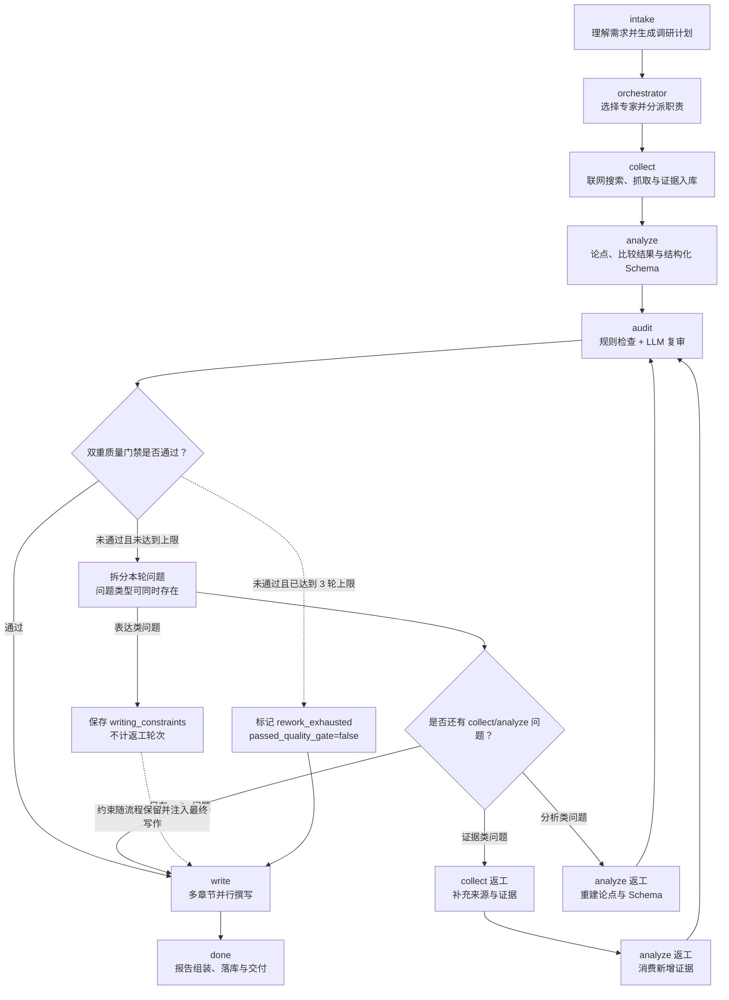

# VerdaAI Investigator 功能实现技术说明

> 文档性质：基于当前仓库源码的实现审计与技术方案说明。
> 审计范围：`backend/` FastAPI 服务、`api/` Serverless 镜像、`frontend/` React 应用及 `docs/` 架构约定。
> 结论口径：
> - **已实现**：源码存在完整调用链，且静态检查可通过。
> - **部分实现**：有可工作的主链路，但与功能描述仍存在能力边界。
> - **未确认**：源码具备接口或数据结构，但未能仅凭代码证明外部服务在当前环境一定可用。

## 1. 系统总体设计

VerdaAI Investigator 是前后端分离的竞品情报系统。前端为 React 19 + Vite + Zustand 单页应用，后端为 FastAPI，业务编排集中在 `backend/app/core/orchestrator.py`，外部依赖包括智谱 GLM、Bocha Web Search 以及公开网页。

核心链路如下：

```text
React 首页
  -> POST /api/tasks
  -> LLM 识别范围并生成澄清问题
  -> POST /api/tasks/{task_id}/clarify
  -> GET /api/tasks/{task_id}/stream (SSE)
  -> intake -> orchestrator -> collect -> analyze -> audit
       -> (rework: collect/analyze) -> write -> done
  -> SQLite 保存报告、证据、Trace、统计
  -> ReportPage / GraphPage / TracePage 渲染结果
```

后端以事件生成器 `run_pipeline()` 推进流程。每个事件包装为 `{type, data}`，FastAPI 再转换为标准 SSE：`event: <type>\ndata: <json>\n\n`。前端 `useTaskStream` 订阅事件并写入 `taskStore`，因此工作台可以在任务运行期间实时展示 DAG、思维流、证据流和进度。

配置通过 `backend/app/core/config.py` 的 Pydantic Settings 读取 `backend/.env` 或环境变量，密钥不写入源码。重要配置包括：`ZHIPU_API_KEY`、`BOCHA_API_KEY`、`SEARCH_PROVIDER`、三个 GLM 模型档位、搜索/LLM 超时以及社媒 cookie。

## 2. 功能一：竞品调研任务入口与三档模式

### 2.1 入口实现

前端 `frontend/src/pages/HomePage.tsx` 提供需求输入框和模式选择器。模式值为 `quick`、`deep`、`expert`，调用 `frontend/src/lib/api.ts` 的 `createTask()`，发送：

```json
{"query": "用户输入的竞品分析需求", "mode": "deep"}
```

后端 `backend/app/main.py` 的 `CreateTaskBody` 接收请求，并调用 `orchestrator.create_task()`。`create_task()` 生成 `t_<uuid>` 任务 ID，立即调用 `_clarify_questions(query)`，将任务及 `_mode` 写入 SQLite `tasks` 表，返回：

```json
{"taskId": "t_xxx", "needClarify": true, "clarifyQuestions": [...]}
```

前端拿到 `needClarify` 后跳转 `/clarify/{taskId}`，形成“创建任务后进入澄清流程”的闭环。

### 2.2 模式配置

`orchestrator.MODE_CONFIG` 集中定义三档差异：

| 模式 | 搜索角度 | 每竞品网页抓取 | 舆情平台条数 | 章节 | 返工轮数 | 模型/写作深度 |
|---|---:|---:|---:|---|---:|---|
| quick | 4 | 6 | 6 | summary/overview/feature/pricing/conclusion | 3 | 3 段，3,500 token/章 |
| deep | 6 | 12 | 8 | 9 个基础章节 | 3 | 5 段，6,000 token/章 |
| expert | 9 | 16 | 10 | 12 个深度章节（含 moat、inflection、contrarian） | 3 | 7 段，9,000 token/章 |

运行时从任务澄清字段 `_mode` 读取模式；非法值降级为 `deep`。这些参数不是前端模拟，而是实际决定搜索量、章节集合、token 预算和返工上限。

### 2.3 实现状态

**已实现**。需要注意：模式差异由配置驱动，实际联网成功率仍依赖 GLM/Bocha 密钥及外部网络。

## 3. 功能二：智能澄清问卷

### 3.1 联网线索 + LLM 归纳方案

这里的“两阶段”容易被误解。当前实现并不是让 LLM 自由生成整份问卷，而是先获取联网线索，再由 LLM 归纳范围：

1. 先联网获取候选线索：`_discover_scope(query)` 使用现有 `multi_search()`，围绕“对象 + 竞品”“对象 + 替代品”“对象 + 同类产品”执行搜索，最多取 24 条去重后的标题、摘要和来源 URL。
2. 再让辅助 LLM 做范围归纳：搜索结果会和原始需求一起传给 `_model("aux")`（默认 `glm-5.1`），要求模型输出 `subject`（调研对象）、`domain`（细分赛道）和 `competitors`（候选竞品）。候选优先来自搜索标题和摘要；模型最多调用 2 次，即第一次失败后再重试 1 次。
3. 最后由后端代码拼装问卷：`_clarify_questions(query)` 读取范围结果。若 `domain` 不为空，就增加“对象/赛道是否准确”的确认题；若 `competitors` 不为空，就增加候选竞品多选题。其余“重点维度、报告视角、目标市场、用户群体、时间范围、补充说明”都是代码中预先定义的固定问题。

例如用户输入“帮我分析 Trae 这款 AI 编程工具的竞品”，LLM 可能返回：

```json
{
  "subject": "Trae",
  "domain": "AI 编程工具/AI 代码编辑器",
  "competitors": ["Cursor", "GitHub Copilot", "Windsurf"]
}
```

后端据此生成：

- “我们识别到对象是 Trae，所属领域是 AI 编程工具，是否准确？”
- “请勾选要重点对比的竞品：Cursor、GitHub Copilot、Windsurf”
- 再加上代码预置的功能、定价、口碑、市场、用户、时间等问题。

因此，**LLM 的作用是结合原始需求和联网线索理解范围、归纳候选竞品**；问卷的结构和大多数选项由后端代码控制，结果更稳定、字段也更容易被后续流水线消费。

候选竞品最终只展示前 12 个。前端 `ClarifyPage.tsx` 还允许用户自行补充竞品，支持逗号、顿号和空格分隔；这些答案会在后续 `_plan_research()` 中与 LLM 计划合并，并优先保留用户指定的竞品。

### 3.2 答案提交与计划重构

这一步分为“保存用户答案”和“正式启动时重建调研计划”两件事，并不是提交答案后立即在接口请求内完成整个调研。

#### 第一步：保存澄清答案

前端点击“启动调研”后，`ClarifyPage.tsx` 调用：

```http
POST /api/tasks/{task_id}/clarify
Content-Type: application/json

{
  "answers": {
    "scope": "准确，继续",
    "competitors": ["Cursor", "Windsurf"],
    "focus": ["功能对比", "定价策略"],
    "perspective": "产品经理（PM）",
    "market": "中国大陆",
    "user": "开发者",
    "freshness": "优先最新（近一月）",
    "extra": "重点关注团队协作能力"
  }
}
```

`main.py` 的接口调用 `submit_clarify(task_id, answers)`。**该函数从 `tasks` 表读取任务原有的 `clarifications`，保留创建任务时写入的内部字段** `_mode`，然后把本次答案写入 `tasks.clarifications`，并把任务状态更新为 `clarified`：

```text
创建任务时：{"_mode": "deep"}
提交问卷后：{"_mode": "deep", "competitors": [...], "focus": [...], ...}
```

因此用户填写的答案不会覆盖 quick/deep/expert 模式。接口返回 `{ "ok": true }` 后，前端跳转工作台；真正的调研由工作台订阅 `/stream` 后启动。

#### 第二步：intake 阶段重建调研计划

SSE 流程进入 `intake` 节点时，`run_pipeline()` 从数据库读取原始 `query` 和澄清答案，然后调用 `_plan_research(query, clar, max_angles)`。该函数使用快速模型（默认 `glm-z1-air`），把两类信息一起放进 Prompt：

- 原始需求，例如“分析 Trae 的 AI 编程工具竞品”；
- 用户补充，例如选中的竞品、关注维度、市场、用户、时间和自由文本。

**模型要求输出一个供后续流水线直接使用的研究计划**：

```
{
  "subject": "Trae",
  "category": "AI 编程工具/AI 代码编辑器",
  "brands": ["Trae", "Cursor", "Windsurf"],
  "focus": ["功能对比", "定价策略"],
  "search_angles": ["产品功能", "定价方案", "用户评测", "最新动态2025"]
}
```

这些字段的下游用途是：

| 字段 | 后续用途 |
|---|---|
| `subject` | 确认核心调研对象；只有像单个产品名时才加入最终品牌列表 |
| `category` | **消除同名歧义，并用于舆情结果相关性过滤** |
| `brands` | **决定要为哪些对象搜索、抓取和生成对比分析** |
| `focus` | **决定分析重点、质检维度覆盖率和章节写作内容** |
| `search_angles` | **拼成“品牌 + 搜索角度”，驱动 Bocha/SerpAPI 多轮检索** |

#### 品牌合并规则

代码不会盲目相信 LLM 返回的品牌顺序，而是按以下优先级合并：

```text
用户在问卷中勾选/补充的 competitors
  > LLM 识别出的单个 subject
  > LLM 返回的 brands
```

合并时逐项去重、保持首次出现的顺序，最后执行 `merged[:6]`。**因此用户明确指定的竞品一定优先进入调研，但正式调研品牌总数最多为 6 个**。`subject` 还会经过检查：长度不能超过 16，且不能包含“对比、分析、调研、与、vs”等描述性词语，避免把“Notion 与 Obsidian 对比分析”误识别成一个品牌。

#### 输出校验与兜底

模型返回后，代码会过滤非字符串品牌和搜索角度，并限制搜索角度数量不超过当前模式的 `max_angles`。**如果模型没有返回有效品牌、JSON 解析失败或调用异常，则不会中断任务**，而是使用：

1. 用户明确勾选的竞品；
2. 如果用户没有勾选，则用 `_regex_brands(query)` 做字符串级保底提取：按中文标点、逗号、斜杠和空格切分原始需求，再排除“分析、对比、报告”等停用词。例如“分析 Trae 与 Cursor 的竞品报告”会被切成若干词，过滤掉“分析、与、的”等词后，尝试保留 `Trae`、`Cursor` 等候选名称。它不是语义理解算法，复杂句子可能把普通词误当成品牌，因此只作为 LLM 失败时的兜底；
3. 默认重点维度 `产品/定价/口碑`；
4. 默认搜索角度 `产品功能/定价方案/用户评测/最新动态2025/市场份额`。

所以**这一步的核心不是“让 LLM 直接开始搜索”，而是把用户的自然语言和问卷答案转换成一个经过清洗、限长、可供 collect/analyze/write 节点使用的结构化调研计划。**

### 3.3 实现状态

**已实现**。当前候选发现已接入联网搜索，但候选的搜索来源只作为本次 LLM 归纳的输入，尚未按候选单独持久化来源或计算独立可信度；搜索服务不可用时会回退到 LLM 和后续正则兜底。

## 4. 功能三：48 位专家协作体系

### 4.1 专家资产

`backend/app/data/experts.json` 和 `api/app/data/experts.json` 各保存一份专家名册。当前统计为：L3 决策层 3 人、L2 策略层 9 人、L1 执行层 36 人，共 48 人。每个专家包含 `id`、`level`、`group`、`name`、`role_title`、`skills`、`knowledge_base`、`knowledge_tags`、`avatar` 等字段。

角色约定写在 `docs/AGENTS.md`：L3 负责拆解、终审和质检；L2 负责策略分析；L1 负责行业/职能采集和执行。

这里的“48 位专家”首先是一组**可被编排器引用的专家画像**，不是 48 个常驻进程，也不是 48 个独立的外部模型账号。`backend/app/data/__init__.py` 的 `load_experts()` 读取 JSON 并缓存名册，`expert_by_id()` 按 ID 查询单个画像。画像的作用有三层：

1. **给 LLM 提供选择依据**：组队时只把每位专家的 ID、姓名、层级、职位和前 3 个技能压缩成 roster，避免把整段知识库全部塞进提示词；
2. **给流水线分配责任标签**：搜索、分析、质检和写作产生的事件都带 `expert` 字段，系统据此说明当前动作由谁负责；
3. **给前端展示和统计使用**：前端用 ID 反查头像、姓名、职位、技能和知识标签，SQLite 只保存工作量计数，不把专家画像复制到每个任务记录中。

后端和 `api/` 目录各保留一份名册，是为了兼容两套启动入口；前端还可以从 `/api/experts` 获取名册，接口不可用时再读取静态 `assets/experts.json`。因此新增或修改专家时需要注意这些副本的一致性。

### 4.2 动态组队

组队发生在 `run_pipeline()` 的 `orchestrator` 节点，而不是创建任务的接口阶段。前一个 `intake` 节点先得到正式的 `brands` 和 `focus`，然后调用 `_dispatch_experts(query, brands, focus)`。组队采用“LLM 推荐、后端裁决”的两阶段方案：LLM 只负责提出候选人和理由，后端负责校验、补齐、去重和最终定案，不能直接把 LLM 输出当成可执行团队。

#### 4.2.1 输入 roster 与输出契约

函数先把 48 人压缩成如下形式的 roster，仅向 LLM 暴露用于选择的字段：

```json
{"id":"L1-025","name":"...","level":"L1","role":"...","skills":["联网检索","...", "..."]}
```

LLM 根据调研主题、竞品和重点维度返回推荐结果。推荐结果必须遵循 JSON Schema，包含成员 ID、推荐理由和建议职责：

```json
{
  "lead": "L3-001",
  "members": [
    {"id": "L3-001", "reason": "负责拆解目标并统筹终审", "responsibilities": ["intake", "orchestrator"]},
    {"id": "L2-002", "reason": "负责定价模型和价格策略", "responsibilities": ["analyze", "pricing"]},
    {"id": "L1-025", "reason": "负责官方网页和公开资料取证", "responsibilities": ["collect"]}
  ]
}
```

LLM 的职责是“推荐”，不是“授权”。后端收到结果后执行严格的 `validate_and_repair_dispatch()`，最终只允许产生满足以下契约的 `DispatchResult`：

```text
lead：必须是 members 中的真实 L3 专家
L3：至少 1 人；lead 占其中 1 人
L2：1–2 人，负责策略和专项分析
L1：3–6 人，负责搜索、抓取、舆情和数据执行
members：ID 唯一、总数不超过 9 人、每人有非空 reason
responsibilities：只能引用系统已定义的阶段/职责
```

#### 4.2.2 后端校验、修复和回退

校验必须按以下顺序执行，任何一步失败都不能直接返回半合法团队：

1. **Schema 校验**：确认根对象、`lead`、`members`、`reason` 类型正确；解析失败直接进入修复/回退。
2. **身份校验**：按 `experts.json` 建立 `id -> expert` 索引，丢弃不存在的 ID；对成员按 ID 去重，保留首次出现的理由。
3. **层级校验**：统计 L3/L2/L1 数量，确认 `lead` 同时存在于成员集合且 `level == "L3"`。
4. **职责校验**：根据 `group`、`skills` 和预定义职责矩阵检查成员是否能承担 `collect`、`analyze`、`audit` 等阶段；LLM 给出的自由文本只能作为展示理由，不能改变系统阶段映射。
5. **自动修复**：缺少某一层时，从未入选的真实专家中补齐。补齐的主判断不依赖 LLM，而由后端根据结构化 `level`、`group`、`skills`、`knowledge_tags` 和预定义职责矩阵计算确定性匹配分；例如 `collect.web` 优先匹配包含网页抓取技能的 L1，`collect.sentiment` 优先匹配舆情/评论技能的 L1，`audit` 优先匹配事实核查和质量审裁能力的 L3。若存在多个同分候选，再使用稳定的 ID 或名册顺序打破平局，保证同样输入得到同样结果。LLM 可以在第一阶段推荐候选人或提供语义匹配建议，但不能覆盖后端层级约束和最终选人结果；**没有满足条件的候选人时使用固定优先级回退，例如网页采集 `L1-025`、舆情 `L1-030`、事实核查 `L1-026`、审计 `L3-003`。**
6. **最终复核**：修复后再次执行完整校验；仍不满足契约时，丢弃 LLM 结果，使用完整固定回退队伍，并记录 `dispatch_source="fallback"` 与失败原因。

固定回退队伍必须自身满足契约，建议使用：

```text
L3-001  决策层：统筹全局与终审
L3-003  决策层：质量审裁
L2-001  策略层：竞争格局判断
L2-002  策略层：定价策略拆解
L1-025  执行层：联网取证
L1-030  执行层：舆情与情感分析
L1-026  执行层：事实核查与来源复核
```

该队伍包含 2 名 L3、2 名 L2、3 名 L1，满足最低执行配额；`lead` 固定为 `L3-001`。回退不是静默发生，系统应在 Trace 和 SSE 中记录 `dispatch_source`、校验问题和最终采用的成员，方便定位模型输出质量。

#### 4.2.3 责任映射和流水线使用

组队结果中除成员列表外，还应生成后端控制的 `assignments`，避免每个节点自行猜测“第一个 L1”或硬编码专家 ID：

| 流水线阶段 | 代码选择的专家 | 实际职责 |
|---|---|---|
| `intake` / `orchestrator` | `assignments.lead` | 需求拆解、团队编排和最终责任人 |
| `collect.web` | `assignments.web_collector` | 普通网页搜索、正文抓取和证据记录 |
| `collect.sentiment` | `assignments.sentiment_collector` | 平台定向检索、口碑采集和情感素材整理 |
| `analyze` | `assignments.analyst` | 基于证据生成论点、比较和结构化数据 |
| `audit` | `assignments.auditor` | 检查证据覆盖、置信度和返工条件 |
| `write` | `assignments.writer` | 负责章节编排和报告写作统筹 |

其中 `assignments` 必须引用 `members` 中的 ID，且每个阶段只能有一个主负责人；需要协作时使用 `assistants` 数组显式记录。分析阶段传给 LLM 的可用 `author` 集合也只能来自最终成员，模型输出未知作者时应拒绝该字段并记录校验问题，而不是静默替换成任意成员。

`run_pipeline()` 会把组队过程实时转成两类 SSE：

- `thought(kind="dispatch")`：逐人发送“姓名、职位、指派理由”，因此在中间思维流能看到为什么选中某人；
- `message(kind="team")`：发送最终成员 ID、层级、理由、`assignments`、`dispatch_source` 和 `Envelope(sender=assignments.lead, receiver="collect", task_type="PRODUCE")`，表示编排节点把采集任务交给 collect 节点。

前端 `taskStore.ingest()` 收到 `kind="team"` 后保存 `teamMembers`，工作台左侧用头像展示队伍；`VAgentStream` 再根据每条 thought 的 `expert` ID 反查姓名和头像，展示阶段标签（规划/派遣/执行/发现/反思）以及具体指派文本。也就是说，前端显示的是同一套 SSE 事件驱动的动态状态，不是自行推断专家结果。

### 4.3 工作量统计

任务完成并成功落库后，`run_pipeline()` 统计三类来源：

- `member_ids`：通过最终校验后的、去重后的全部成员；
- `claims_by_author`：分析结果中每条 claim 的 `author` 计数；
- `ev_by_collector`：每条 `Evidence.collected_by` 的证据计数。

随后调用 `db.bump_expert_stats(member_ids, claims_by_author, ev_by_collector)`。统计函数只接受最终校验后的团队快照，不能使用未经清洗的 LLM 原始成员列表。数据库表 `expert_stats` 的字段含义是：

| 字段 | 增长规则 |
|---|---|
| `missions` | 只要专家出现在本次派遣成员列表中，就增加 1 |
| `claims_authored` | 该专家作为 claim `author` 出现几次，就增加几次 |
| `evidence_collected` | 该专家作为 `collected_by` 出现几次，就增加几次 |
| `last_active` | 本次任务完成时刷新为当前时间 |

`bump_expert_stats()` 使用 SQLite 的 `INSERT ... ON CONFLICT DO UPDATE`，所以第一次出现会插入记录，之后按专家 ID 累加，不会覆盖历史值。即使某个专家只负责统筹、没有直接产出 claim 或 evidence，也会因为属于 `member_ids` 而获得 `missions + 1`。

`GET /api/experts/workload` 不直接返回数据库行，而是先读取完整 48 人名册，再按 ID 合并统计。没有历史记录的专家也会返回 0，保证前端可以展示完整名册；最后按 `missions`、`claims_authored`、`evidence_collected` 倒序排列。专家详情页和 Dashboard 使用这些字段显示累计参与调研、结论数、证据数和最近活跃时间。

需要注意统计的口径：它统计的是**任务角色和产出归属**，不是 CPU 时间、真实人工工时，也不是独立模型调用次数；同一个任务中一个专家可以同时拥有一次 `missions`、多条 `claims_authored` 和多条 `evidence_collected`。

### 4.4 一条任务的完整示例

用户提交“分析 Trae、Cursor 的定价和开发者口碑”后，可能经历如下过程：

1. `intake` 生成 `brands=["Trae","Cursor"]`、`focus=["定价策略","用户口碑"]`；
2. `orchestrator` 把 48 人画像交给快速模型，模型推荐成员和理由；后端发现缺少第三名 L1 后补入 `L1-026`，并确认 `lead=L3-001` 属于最终成员；
3. 后端生成 `assignments`：`lead=L3-001`、`web_collector=L1-025`、`sentiment_collector=L1-030`、`analyst=L2-002`、`auditor=L3-003`、`writer=L3-001`；
4. `collect` 用 `L1-025` 写入普通网页证据，用 `L1-030` 写入平台舆情证据；每条证据的 `collected_by` 只能使用 assignments 中的合法成员 ID；
5. `analyze` 将 `L2-002` 作为主要策略作者，并把证据 ID 绑定到 claim；每个 claim 的 `author` 必须属于最终成员集合；
6. `audit` 由 `L3-003` 检查证据覆盖和置信度，不通过时触发采集或分析返工；
7. 完成后可能写入：`L3-001.missions += 1`、`L2-002.claims_authored += 4`、`L1-025.evidence_collected += 18`、`L1-030.evidence_collected += 10`。

这里的“专家协作”体现为：不同节点使用不同专家身份、提示词职责、证据归属和可观测事件，最终由同一个后端流水线协调完成；并不是 4 个专家进程通过网络互相发送消息。

### 4.5 实现要求与边界

该功能的合理实现应以“最终组队结果可验证”为验收标准：名册加载、LLM 推荐、Schema 校验、成员去重、L3 负责人约束、L3/L2/L1 配额、职责映射、失败回退、SSE 派遣展示、论点/证据归属和 SQLite 工作量累计必须形成一条闭环。组队结果一旦通过校验，就应作为本次任务的不可变快照写入任务上下文，后续节点不得重新按“第一个 L1”或硬编码 ID 猜测负责人。

这里的“专家”仍然是带知识画像的 LLM 角色，不是 48 个独立运行的进程。真正的异步并发主要发生在报告章节写作阶段；专家协作的核心是角色选择、阶段责任映射、证据/结论作者归属和可观测事件，而不是创建 48 个常驻 Agent。

`knowledge_base` 继续作为专家能力说明和前端详情展示字段；如果未来要让它真正参与推理，需要额外建设文档切分、向量索引、检索权限和引用回溯，不能仅凭 JSON 中的一段描述声称已经实现知识库增强。

### 4.6 Multi-Agent 定性、通信与自治边界

本项目可以称为**基于中心编排器的角色化 Multi-Agent 工作流**，但不应描述为“48 个自治 Agent 组成的分布式系统”。这里需要区分产品层的角色协作和运行时的 Agent 独立性：

| 能力 | 当前实现 | 结论 |
|---|---|---|
| 采集、分析、写作、质检等专职角色 | 每个阶段绑定不同专家 ID、职责 Prompt 和产出归属 | 已实现 |
| 角色动态组队 | LLM 推荐，后端校验、补齐和回退 | 已实现 |
| 证据、论点和结构化 Schema 的阶段传递 | `Evidence` → `Claim`/Schema → 质检 → 写作 | 已实现 |
| DAG 式节点流转 | `intake`、`orchestrator`、`collect`、`analyze`、`audit`、`write`、`done`，并支持返工分支 | 基本实现 |
| 交叉审查闭环 | 质检决定返采集或重分析，返工后再次审阅 | 已实现 |
| 每个角色独立进程/独立 Agent 会话 | 所有阶段由同一个 `run_pipeline()` 调度，共享模型池 | 未实现 |
| 专家点对点自主通信 | 没有独立 mailbox、消息队列或 Agent 消费循环 | 未实现 |
| 每个专家自主选择工具的 ReAct 循环 | 工具调用路径由代码预先固定 | 未实现 |

#### 4.6.1 当前的“通信”是什么

代码定义了 `Envelope`，字段包括 `sender`、`receiver`、`task_type`、`payload`、`issues` 和 `trace_ref`。它用于表达阶段间的任务交接和返工请求，例如：

```text
orchestrator -> collect   PRODUCE：按品牌和搜索角度采集证据
audit -> collect          REWORK：某些品牌证据不足，补充采集
audit -> analyze          REWORK：维度或 Schema 不完整，重新分析
```

这些消息是**同一进程内的结构化控制数据**。`run_pipeline()` 创建或接收 `Envelope`，读取 `receiver` 后直接进入采集或分析代码分支；消息没有经过网络 RPC、消息代理或独立 Agent 的接收循环。因此它实现了“阶段间协议”和“可追踪的任务交接”，但不等于专家之间的自治点对点通信。

SSE 的 `thought`、`message`、`team` 和 `trace` 事件也不是 Agent 通信通道。它们用于向前端展示阶段进度、专家归属、证据和决策回放；前端事件不会被另一个专家自动消费并回复。

#### 4.6.2 各角色的局部决策能力

当前角色拥有的是**受约束的局部决策**，最终流程控制权仍在后端：

- **编排角色**：LLM 可以根据主题、竞品和技能推荐团队、负责人和指派理由；后端再校验 ID、层级配额、职责和 `lead` 约束，必要时补齐或回退。
- **采集角色**：`_collect_brand()` 按固定流程执行搜索、抓取、去重、正文相关性过滤和 Evidence 生成。是否跳过链接、是否停止抓取、是否回退平台搜索均由代码规则决定，角色不能自行发明新的搜索策略。
- **分析角色**：LLM 可以在给定证据和 Schema 内选择支持结论的证据、组织比较结果和填写结构化字段；后端过滤非法 `evidence_id`/`author`，并重新计算置信度。
- **质检角色**：规则函数 `evaluate_quality()` 计算覆盖率等指标，`llm_quality_review()` 给出审阅意见，`decide_rework()` 只能在 `pass`、返采集、重分析等预定义路径中作出选择。
- **写作角色**：LLM 可以决定章节表达、段落组织和摘要重点，但不能改变团队、证据或全局流水线；章节间只是读取同一上下文并行生成。

因此，当前系统存在“单次 LLM 语义判断”和“确定性代码路由”，但没有开放式自主决策。尤其要区分普通业务循环和 ReAct：遍历品牌、平台、搜索角度的 `for` 循环，以及 LLM 限流/JSON 失败重试，都不是“观察 → 选工具 → 执行 → 再观察”的 ReAct 循环。

#### 4.6.3 验收口径

若需求中的“Agent 协作系统”指一个可运行的竞品调研产品，当前实现已经覆盖采集、分析、写作、质检、知识 Schema、DAG 流程和返工闭环；若“独立 Agent”要求每个角色拥有独立上下文、工具权限、持续运行循环并能与其他 Agent 自主协商，则当前实现不完全满足。

当前架构的准确表述是：

> 中心编排器 + 多专家角色画像 + 共享产物传递 + 结构化返工消息 + 受约束的 LLM 阶段决策。

要升级为严格意义的自治 Multi-Agent 系统，还需要为采集、分析、写作和质检分别提供 Agent Runtime、独立会话状态、工具注册表、消息队列或 mailbox、`observe → decide → act` 循环、权限/预算/超时控制，以及冲突解决和跨 Agent 会话 Trace。

## 5. 功能四：Deep Research 式流水线与实时可视化

### 5.1 节点声明不等于实际执行顺序

`DAG_NODES` 声明了七个用于前端展示的节点：`intake`、`orchestrator`、`collect`、`analyze`、`write`、`audit`、`done`。该数组提供节点 ID、名称和初始展示顺序，本身不负责调度，也不决定运行时先执行哪个节点。

真正的执行顺序由 `run_pipeline()` 中各阶段代码及其发出的 `node_update` 事件决定。当前主路径实际为：

```text
intake → orchestrator → collect → analyze → audit → write → done
```

因此，当前实现会在 `analyze` 之后先进入 `audit`，而不是先写报告。代码文件头部注释以及 `DAG_NODES` 中仍保留了 `write → audit` 的旧顺序，它们与 `run_pipeline()` 的实际行为不一致，不能作为运行顺序的判断依据。

### 5.2 各节点的实际职责

- **intake**：调用 `_plan_research()`，将原始需求和澄清答案整理为调研对象、竞品范围、重点维度和搜索角度。
- **orchestrator**：调用 `_dispatch_experts()` 选择本次任务使用的专家画像，并向采集阶段发出结构化 `Envelope(PRODUCE)`。
- **collect**：按品牌执行 `_collect_brand()`，完成搜索、网页抓取、证据去重和 Evidence 生成；随后补充多平台公开舆情数据。
- **analyze**：调用 `_analyze()` 生成带 `evidence_ids` 的论点和比较数据，调用 `_analyze_structured()` 生成 `feature_tree`、`pricing_model`、`user_persona`，并执行舆情情感分类。
- **audit**：同时执行 `evaluate_quality()` 规则检查和 `llm_quality_review()` 语义复审。只有规则问题为空、LLM 判定为 `pass` 且 LLM 阻断问题为空，才算通过质量门禁。
- **write**：质量门禁通过，或者达到返工次数上限后，按章节异步并行执行 `_write_single_section()`。核心章节和辅助章节可使用不同模型。
- **done**：组装最终报告，保存质检状态和返工记录，计算指标，写入 SQLite，保存 Trace，更新任务状态并发出 `report_ready`、`done` 事件。

### 5.3 为什么在写作前质检

当前 `audit` 审查的对象是**分析中间产物**，主要包括证据覆盖、结构化论点、置信度、维度覆盖和知识 Schema，而不是已经写完的报告正文。

将这次质检放在 `write` 前有两个目的：

1. 在生成多章节报告前发现证据不足、论点错误或结构缺失，减少基于错误分析继续写作造成的模型与 Token 浪费。
2. 允许质检结果回到负责修复问题的阶段；修复后的产物沿依赖链向下游重新计算，再执行规则检查和 LLM 复审。

返工路由如下：

- 证据不足、缺少来源、交叉验证不足等问题路由到 `collect`。
- 论点逻辑、维度遗漏、Schema 或结论结构问题路由到 `analyze`。
- 表达、段落、标题、重复和可读性问题路由到 `write`，作为后续章节生成的约束条件。

这里的路由目标表示“由哪个阶段负责修复”，不表示三个返工分支完成后都直接回到 `audit`。补采会改变证据集合，因此必须重新执行 `analyze`，让论点和 Schema 消费新增证据；分析返工完成后才回到 `audit`；写作类反馈则直接交给 `write` 执行。只有产生了新的待审产物，重新质检才有意义。

### 5.4 阶段流转与正确返工路径



图中的“最多 3 轮仍未通过”不是质量通过。系统会按照当前产品策略继续生成报告，但在 `audit_review` 中保留 `rework_exhausted=true`、`passed_quality_gate=false` 和最终复审结论，避免把耗尽返工次数误显示为质检成功。

图中的三类问题不是互斥分支。同一轮可以同时保存 writing constraints、补采证据并重建分析；只有 collect/analyze 会修改分析中间产物、消耗返工轮次并触发再次质检。若只有 write 问题，则没有可供分析质检重新检查的新产物，系统会将约束注入章节 Prompt 后直接进入 write。

图中三条返工路径的含义分别是：

- `audit → collect → analyze → audit`：新增证据必须重新进入分析，更新 Claims、结构化 Schema 和证据绑定后才能复审。
- `audit → analyze → audit`：只重建分析中间产物，然后对新产物进行双重质检。
- `audit → writing_constraints → write → done`：仅有表达问题时不重复质检、不消耗返工轮次，直接把写作约束注入章节 Prompt。当前没有 `report_audit`，所以不能声称这里已经形成“写作 → 复审 → 重写”的闭环。

由于存在前两条回跳，流程从严格的图论定义看不是无环的 DAG，而是**带有限返工循环的状态工作流图**。“DAG”主要指前端对阶段依赖和执行状态的可视化表达。

### 5.5 SSE 事件与实时可视化

`main.py` 的 `stream_task()` 将流水线事件转换成 SSE。当前事件类型包括：`node_update`、`thought`、`message`、`evidence`、`chart`、`image`、`progress`、`trace`、`report_ready`、`done`、`error`。

各类事件的用途如下：

- `node_update`：更新节点的 `idle`、`working`、`rework`、`done` 状态，并携带当前负责专家。
- `progress`：同步整体百分比、当前阶段、证据数量和 Token 消耗。
- `thought`、`message`：展示阶段动作、发现、团队指派、质检结果和返工原因。
- `evidence`、`image`、`chart`：增量展示采集证据、图片和分析图表。
- `trace`：记录模型、阶段、调用目的、耗时、Token 和相关证据。
- `report_ready`、`done`：通知前端报告已落库并可跳转查看。

前端 `frontend/src/lib/api.ts` 的 `openTaskStream()` 注册上述事件，`useTaskStream.ts` 管理 SSE 连接生命周期，`taskStore.ts` 保存节点、消息、证据、图表、Trace 和进度状态。`VFlowDag` 按后端提供的节点数组纵向渲染流程状态，`VAgentStream` 展示思维和消息流，`VEvidenceFeed` 展示实时证据流。

需要注意：`VFlowDag` 当前只是按数组顺序绘制纵向时间线，并根据事件更新状态；它不会根据运行历史动态计算拓扑，也不会真正绘制返工边。因此后端可以先发出 `audit=working`，即使展示数组中 `write` 仍排在 `audit` 前面，这也是当前界面可能出现节点顺序观感不一致的原因。

### 5.6 当前设计边界

当前只有一次位于写作前的分析质检，没有在章节全部生成后再次审查最终报告正文。因此：

- `analyze` 类问题已经形成“重分析 → 再次规则检查 → 再次 LLM 复审”的真实闭环。
- `collect` 类返工会由 `ensure_collect_reanalysis()` 强制衔接 `analyze`：如果本轮原本没有 analyze Envelope，编排器会在最后一个 collect Envelope 后自动插入；如果已有则不重复。补采完成后会重新调用 `_analyze()` 和 `_analyze_structured()`，再进入双重质检。
- `write` 类问题在当前阶段只会累积为首次写作的 Prompt 约束。纯 write 问题会直接进入写作；若与 collect/analyze 问题并存，则等待分析返工通过或耗尽后再进入写作。它仍不是“先写报告 → 审查报告 → 重写报告”的完整闭环。
- 最终报告中新增的表述错误、章节间矛盾或正文引用错位，不会被当前写作前质检发现。

如果后续要求对最终报告表达进行交叉审查，应将单一 `audit` 拆分为两个职责明确的阶段：

```text
collect → analyze → analysis_audit → write → report_audit → done
                         ↑                    │
                         └─ 补采/重分析返工   └─ 章节重写返工
```

其中 `analysis_audit` 负责证据、论点和 Schema，`report_audit` 负责最终正文的表达、章节一致性、引用呈现和可读性。该双审查结构是后续建议方案，**当前代码尚未实现写作后的 `report_audit`**。

### 5.7 实现状态

**主体已实现，但展示定义和写后审查仍存在不足。** 后端已经实现实际主路径、双重质量门禁、collect 后强制重分析、最多 3 轮返工、耗尽状态保留以及 SSE 实时事件；它是代码驱动的状态工作流，不是 Temporal、Airflow 等独立工作流引擎。当前仍需注意：`DAG_NODES` 展示顺序尚未同步实际执行顺序，前端未绘制真实返工边，`write` 反馈尚未形成写后复审闭环。任务重启、并发取消和跨进程恢复能力也仍然有限。

## 6. 功能五：真实联网取证与证据溯源

### 6.1 搜索层

项目中的“联网搜索”包含三个不同层次：搜索服务提供商、业务搜索策略和网页正文抓取。三者职责不同，不能把 `httpx` 抓取网页理解为另一种搜索引擎。

`backend/app/core/search.py` 实现了三个搜索提供商适配器：

| 提供商 | 请求与鉴权 | 站点限定 | 时效过滤 | 原始结果字段 |
|---|---|---|---|---|
| Bocha Web Search | `POST {BOCHA_BASE_URL}/web-search`，Bearer Token | 请求体 `include` | 原生 `freshness` | `data.webPages.value` |
| SerpAPI | Google engine，GET 请求，`api_key` 参数 | 查询词中拼接 `site:` | `tbs=qdr:d/w/m/y` | `organic_results` |
| Serper.dev | `POST SERPER_BASE_URL`，`X-API-KEY` 请求头 | 查询词中拼接 `site:` | `tbs=qdr:d/w/m/y` | `organic` |

三个适配器的 HTTP 请求、鉴权、参数和响应解析并不相同，但都会转换成相同的内部结果结构：

```json
{
  "title": "页面标题",
  "url": "页面地址",
  "snippet": "搜索摘要",
  "source": "来源名称或展示域名",
  "captured_at": "发布时间或采集时间"
}
```

`search()` 是统一入口，根据 `SEARCH_PROVIDER` **只选择一个**提供商：`bocha` 调用 `search_bocha()`，`serpapi`/`serp`/`google` 调用 `search_serpapi()`，`serper` 调用 `search_serper()`。配置多个 API Key 不代表系统会同时搜索多个提供商，也不会自动合并三家的结果。当前 `backend/.env` 设置为 `SEARCH_PROVIDER=serper`，所以本地后端实际使用 Serper.dev。

当前代码没有跨提供商自动容灾。例如 Serper 额度耗尽时，不会自动切换到 Bocha 或 SerpAPI，而是把异常交给上层。`multi_search()` 会依次执行多条查询，跳过其中失败的查询，按 URL 去重并在结果中记录原始 `query`；这属于“单个查询失败后继续”，不是“搜索提供商故障切换”。

三个提供商返回结果后都会经过 `_is_relevant()` 轻量相关性过滤：优先检查查询中的第一个英文词或中文词组是否出现在标题、摘要中；未直接命中时，再按多个查询词的总命中数进行宽松判断，以剔除明显跑题的结果。

### 6.2 两类业务搜索策略

普通竞品取证采用“品牌 × 搜索角度”的全网多查询策略。`_collect_brand()` 把规划阶段生成的 `search_angles` 与每个品牌组合，例如：

```text
Trae 产品功能
Trae 定价方案
Trae 用户评价
Trae 最新动态
```

这些查询统一交给 `multi_search()`，经相关性过滤和 URL 去重后，再按模式配置的 `fetch_per_brand` 上限读取网页正文。

舆情取证使用相同的 `search()`/`multi_search()` 底层入口和同一个 `SEARCH_PROVIDER`，但查询组织方式不同**。编排器会围绕目标品牌生成“评价、怎么样、优缺点、测评”等查询，并通过 `site` 参数分别限定到抖音、小红书、B 站、微博和知乎**。例如：

```text
site:zhihu.com Trae AI 编程工具 评价
site:bilibili.com Trae AI 编程工具 测评
```

若某个平台的站点限定查询没有结果，系统会退回带平台名称的全网搜索，例如“Trae 知乎 评价”。因此普通取证和舆情取证并不是两套搜索引擎：二者共用提供商适配层，但查询构造、站点限制、过滤和后续处理不同。

| 对比项 | 普通竞品取证 | 多平台舆情取证 |
|---|---|---|
| 搜索范围 | 全网 | 优先指定平台域名，失败后回退全网 |
| 查询形式 | 品牌 + 功能/定价/动态等研究角度 | 品牌 + 评价/体验/优缺点/测评 |
| 内容来源 | 搜索结果 + 目标网页正文 | 主要使用搜索结果标题和摘要 |
| 后续处理 | 正文相关性校验、证据评分、图片提取 | 品牌/品类相关性校验、平台识别、情感分类 |

### 6.3 网页正文抓取与降级

搜索 API 只负责发现候选 URL 和返回摘要。普通竞品取证随后调用 `fetcher.fetch_page()`，使用 `httpx.Client` 拉取 HTML，跟随重定向并设置浏览器 UA；正文优先由 `trafilatura.extract()` 提取，失败时用 BeautifulSoup 清理 `script`、`style`、导航和页脚等标签，再拼接有效段落。BeautifulSoup 还用于提取普通图片以及 OG/Twitter 分享图。

```text
搜索 API
  → 标题、URL、摘要
  → httpx 下载目标网页
  → trafilatura 提取正文
  → BeautifulSoup 兜底提取正文和图片
  → 相关性校验
  → 生成 Evidence
```

编码异常时会尝试 UTF-8、GBK、GB18030 重新解码。请求失败、正文抽取失败或正文乱码时，`fetch_page()` 保留搜索摘要作为降级内容，并返回 `degraded=true`。当前实现没有使用 Playwright、Selenium 等浏览器渲染方案，因此依赖 JavaScript 才能呈现正文的页面可能只能获得摘要或空正文。

舆情采集目前主要直接使用搜索结果的 `snippet` 或标题生成舆情样本和 Evidence，不会对每一条社媒链接调用 `fetch_page()` 抓取完整正文。因此它与普通网页取证的“搜索后抓正文”实现并不完全相同。

### 6.4 Evidence 数据模型与溯源

`Evidence` dataclass 包含：`evidence_id`、`source_url`、`source_type`、`title`、`excerpt`、`captured_at`、`credibility`、`collected_by`、`image_urls`、`brand`、`domain`、`freshness_days`。ID 使用 `_sid("e")` 生成，形式为 `e_<uuid8>`。采集过程中每条证据以 `evidence` SSE 事件发送，最终写入 `evidences` 表。

`_collect_brand()` 还会做 URL 去重、正文相关性过滤、来源类型识别和图片精选；来源类型由 `_source_type()` 根据域名映射为 official/news/financial_report/zhihu/bilibili/weibo/xiaohongshu/douyin 等。

### 6.5 可信度评分

`credibility.score_evidence()` 是可解释规则模型，不是固定常数：来源类型基分 + 权威域名加分 + 低质域名扣分 + 发布时间/新鲜度 + 抓取质量 + 社媒互动信号。结果限制在 5-98。

### 6.6 为什么使用搜索服务提供商

搜索服务与网页抓取解决的是两个不同问题：

- **搜索发现**回答“互联网上有哪些与查询相关的网页”，需要从全网索引中召回候选 URL 并完成相关性排序；
- **网页抓取**回答“已知 URL 中有什么内容”，负责下载 HTML、抽取正文和图片。

当前项目只把搜索发现交给 Bocha、SerpAPI 或 Serper，网页下载、正文解析、相关性校验、Evidence 生成、证据评分和后续分析仍由项目自身完成。因此，使用搜索服务不等于把整个调研流程外包给服务商。

如果完全自行实现通用网页搜索，需要长期建设以下能力：

```text
全网 URL 发现
  → 大规模持续抓取
  → 网页去重和更新检测
  → 中文分词与倒排索引
  → 相关性及时效性排序
  → 低质量内容和搜索垃圾过滤
  → site: 等查询能力
```

这类系统需要持续消耗存储、带宽和计算资源。仅实现一个爬虫只能读取已经知道的 URL，无法自动获得与搜索引擎相当的网页发现范围。知乎、微博、小红书、抖音等平台还存在动态渲染、登录校验、限流和反自动化机制，并涉及 robots.txt、平台服务条款、内容授权和个人信息处理等合规要求。

因此，本项目当前调用搜索服务的核心原因，是利用现成的网页索引、召回和排序能力发现候选来源，再由自身采集链路完成取证和分析。

### 6.7 自建联网检索的可行范围

“自行实现搜索”可以分为三个层级，其成本和覆盖范围明显不同。

#### 6.7.1 自行抓取已知网页

对于用户提供的 URL，或已经由其他渠道发现的 URL，可以直接执行：

```text
已知 URL
  → httpx 下载
  → trafilatura/BeautifulSoup 解析
  → Evidence 入库
```

这一层项目已经实现，但它仍需要外部搜索、用户输入、站点地图或历史证据库提供初始 URL。

#### 6.7.2 建设定向站点搜索

如果调研范围集中在有限的品牌官网、产品目录、行业媒体和社区，可以维护种子 URL，定期遍历站内链接并为抓取结果建立本地全文索引：

```text
种子 URL
  → 定向或增量抓取
  → 内容清洗与去重
  → 本地全文索引
  → 检索与排序
```

可选技术包括 Scrapy（抓取与调度）、Playwright（必要时处理 JavaScript 渲染）、OpenSearch/Elasticsearch（全文索引）、SQLite/PostgreSQL（元数据与证据存储）以及 Redis/Celery（任务队列）。这种方案适合固定信息源和垂直领域，可以降低重复调用搜索 API 的成本，但不能覆盖整个开放互联网。

SearXNG 也可以作为统一搜索入口，但它是元搜索系统，通常仍需要查询 Google、Bing 等上游来源，并不自行维护完整的全网索引。因此它能降低对单一 API 的绑定，却不能完全消除外部搜索依赖。

#### 6.7.3 自建通用搜索引擎

自行建设覆盖开放互联网的搜索引擎在技术上可行，但需要大规模爬虫集群、分布式索引、排序模型、反垃圾系统以及持续更新能力。其建设和运维成本与本项目的竞品分析目标不匹配，现阶段不建议作为核心实现方向。

### 6.8 推荐的混合搜索架构

更适合本项目的演进方向是“本地资产优先、定向采集补充、外部搜索兜底”：

```text
                         ┌→ 历史证据库/本地全文索引
用户调研请求 → 搜索路由 ├→ 品牌官网和重点来源定向抓取
                         └→ Serper/Bocha/SerpAPI 全网发现
                                      ↓
                             统一抓取与 Evidence 生成
                                      ↓
                             去重、入库并更新本地索引
```

建议执行顺序如下：

1. 优先查询 SQLite 或 OpenSearch 中已有的网页、历史 Evidence 和结构化资产；
2. 对品牌官网、定价页、更新日志等高价值固定来源执行定向增量抓取；
3. 本地材料不足时，再调用外部搜索服务发现新 URL；
4. 新网页经过正文提取、相关性校验和可信度评分后进入证据库与本地索引；
5. 后续任务复用已有资产，只对过期或缺失内容联网补采；
6. 搜索适配层保留多个提供商，并增加按错误类型、额度和超时状态进行自动切换的能力。

这种架构能够逐步减少 API 调用量和单一提供商依赖，同时保留开放网络的信息覆盖。如果完全取消第三方搜索，系统仍可分析用户提交的 URL 和预先维护的站点，但无法可靠地自动发现全网竞品资料。

### 6.9 实现状态

**基础联网取证已实现，混合搜索架构尚未实现**。现有代码已经具备外部搜索提供商适配、普通取证、平台定向检索、正文抓取、摘要降级、URL 去重和 Evidence 溯源能力。第 6.8 节描述的本地全文索引、固定来源增量抓取、历史证据优先召回和跨提供商自动容灾属于后续技术方案，当前不能视为已有功能。

## 7. 功能六：多平台舆情采集与情感分类

### 7.1 流程定位

舆情采集是 `collect` 阶段中普通网页取证之后的一条独立采集链路，随后在 `analyze` 和 `write` 阶段继续处理。完整过程为：

```text
选择主体与主要竞品
  → 按品牌、平台、口碑角度构造查询
  → site: 定向搜索
  → 无结果时回退到带平台名称的全网搜索
  → 品牌和品类相关性过滤
  → 生成舆情 Evidence
  → LLM 情感分类，失败时规则兜底
  → 统计平台/品牌分布并形成观点阵营
  → 生成代表原声、亮点、图表和报告专章
```

平台定义位于 `sentiment.py` 的 `PLATFORM_SITES`，当前覆盖抖音、小红书、B 站、微博和知乎。所有平台仍共用第 6 章所述的 `search()`/`multi_search()` 入口和当前 `SEARCH_PROVIDER`，并不是分别连接五个平台的数据接口。

### 7.2 三档模式的采集规模

编排器从规划后的 `brands` 列表头部选取主体和主要竞品，覆盖数量及单个平台最终保留结果上限由 `MODE_CONFIG` 决定：

| 模式 | `sentiment_brands` | `platform_take` | 含义 |
|---|---:|---:|---|
| quick | 2 | 5 | 最多覆盖主体和 1 个竞品，每个品牌/平台保留最多 5 条 |
| deep | 3 | 8 | 最多覆盖主体和 2 个竞品，每个品牌/平台保留最多 8 条 |
| expert | 4 | 10 | 最多覆盖主体和 3 个竞品，每个品牌/平台保留最多 10 条 |

`platform_take` 限制的是多条查询聚合后最终保留的结果数，不是搜索 API 的调用次数，也不是每一条查询分别保留的数量。

### 7.3 平台定向检索与回退

针对每个品牌和每个平台，编排器构造四条带品类信息的查询：

```text
品牌 + 品类 + 评价
品牌 + 品类 + 怎么样
品牌 + 品类 + 优缺点
品牌 + 品类 + 测评
```

第一轮把平台域名作为 `site` 参数传给搜索层。例如在 Serper/SerpAPI 中会形成类似下面的查询：

```text
site:zhihu.com Trae AI 编程工具 评价
site:bilibili.com Trae AI 编程工具 测评
```

如果某个品牌在某个平台的四条定向查询聚合后仍没有结果，系统再执行三条回退查询：

```text
品牌 + 品类 + 平台名 + 评价
品牌 + 品类 + 平台名 + 怎么样
品牌 + 品类 + 平台名 + 体验
```

回退搜索不再限定域名，而是从全网结果中寻找与该平台相关的内容。`multi_search()` 会逐条调用搜索 API，所以一次舆情阶段可能产生的查询调用数为：

| 模式 | 第一轮最多调用 | 全部触发回退时最多增加 | 理论上限 |
|---|---:|---:|---:|
| quick | `2 × 5 × 4 = 40` | `2 × 5 × 3 = 30` | 70 |
| deep | `3 × 5 × 4 = 60` | `3 × 5 × 3 = 45` | 105 |
| expert | `4 × 5 × 4 = 80` | `4 × 5 × 3 = 60` | 140 |

这些是按当前代码计算的查询上限，并不表示每次都会全部成功或产生对应数量的证据；但它说明舆情采集可能是搜索 API 额度消耗最大的环节之一。

### 7.4 相关性过滤与证据生成

搜索结果经过 `_sentiment_relevant()` 校验：标题或摘要命中品牌名时直接保留；品牌名未命中时，必须出现由品类拆分得到的关键词，否则视为同名对象或无关内容并丢弃。该步骤用于降低 Trae 等名称存在歧义时的跑题概率。

通过过滤的记录保存 `text`、`platform`、`url`、`title` 和 `brand`，同时生成带唯一 `evidence_id` 的 Evidence，进入全局证据流和数据库。平台归属优先根据真实 URL 域名识别；无法识别为社媒域名时，保留当前搜索的平台上下文。

需要注意，当前舆情链路主要使用搜索结果的 `snippet`，摘要为空时才使用标题，并不会对每条社媒链接调用 `fetch_page()` 抓取完整帖子或评论。因此当前样本更准确的定义是“来自相关平台的公开搜索结果及其摘要”，不能保证每一条都是平台评论区中的完整用户评论。Evidence 评分时也显式使用 `ok_fetch=False`，说明正文没有完成二次抓取验证。

### 7.5 情感分类与观点加工

`analyze_sentiment()` 只要收到非空样本，就先调用 LLM 批量输出每条样本的 `pos`、`neu` 或 `neg` 标签，不存在“达到某个样本量阈值才调用 LLM”的条件。LLM 调用失败、返回格式错误或漏掉个别序号时，才由 `_rule_sentiment()` 根据正负面关键词完成兜底分类。

分类完成后生成：

- 整体正面、中性和负面数量及百分比；
- 各平台的情感数量分布；
- 各品牌的样本量和情感比例；
- 看好、质疑、观望等观点阵营及代表链接；
- 各平台代表性原声；
- 由 LLM 从真实样本中选取或提炼的代表性短语。

`_normalize_pct()` 使用归一化和余数分配保证三类百分比合计为 100%。`_extract_highlights()` 会产生第二次 LLM 调用，用于选择代表性“金句”；失败时返回空列表，不影响主流程。

### 7.6 报告输出

存在有效样本时，写作阶段还会调用 `_write_sentiment_narrative()`，让辅助模型基于真实统计、观点阵营和代表原声生成“全网舆情与观点阵营”章节。`_build_charts()` 同时生成整体情感环形图和平台声量柱状图，前端由 `VSentimentPanel` 渲染统计、阵营、亮点和原声。

报告组装时会始终插入舆情专章：有样本时展示分析结果；没有样本时仍保留章节，但明确说明没有检索到有效评论，因此不做定量结论。

### 7.7 是否每次调研都会执行

**按照当前实现，每次都会尝试执行。** quick、deep、expert 三种模式都配置了 `sentiment_brands`，主流水线也没有根据用户是否勾选“用户口碑”或“舆情趋势”来跳过这段代码，更没有 `enable_sentiment` 开关。只要任务正常运行到 `collect` 阶段，就会执行多平台搜索；即使最终没有有效样本，也已经发生搜索请求。

因此，当前澄清问卷中的重点维度只影响研究规划和报告重点，不会控制舆情采集是否启动。任务被取消、在此前异常终止或没有进入该代码段时，才不会执行。

### 7.8 当前设计问题与建议

1. **没有按调研需求启用。** 只关注功能、定价或技术架构的任务仍会执行数十次舆情搜索，增加耗时和搜索额度消耗。
2. **样本语义可能被高估。** 搜索摘要可能来自文章、视频页面或二次转载，不能统一等同于真实评论正文。
3. **多品牌情感分类存在目标错配风险。** 当前把主体和竞品样本合并后调用 `analyze_sentiment(primary_brand, sentiment_comments)`，而 LLM Prompt 中只有第一个品牌被定义为“目标品牌”。竞品样本可能因此被错误地按照对主体品牌的态度分类。更合理的方式是按 `brand` 分组分别分类，再汇总横向比较。
4. **查询数量较高。** `platform_take` 只限制保留结果，不能减少前面的四条定向查询和最多三条回退查询。

建议增加显式舆情策略：用户选择“用户口碑”或“舆情趋势”时执行完整采集；综合报告可以降低到主体和一个主要竞品；纯功能、定价或技术对比任务可以跳过舆情采集和舆情章节。与此同时，应按品牌独立执行情感分类，并在界面和报告中把当前数据标注为“公开搜索结果摘要”，除非未来接入正文抓取或平台官方数据接口。

### 7.9 实现状态

**多平台定向搜索、相关性过滤、Evidence 入库、LLM 情感分类、规则兜底、统计聚合、图表和报告专章均已实现；按需启停和按品牌独立分类尚未实现。** 源码未接入抖音、小红书、B 站等平台的官方评论 API，也没有登录态浏览器采集链路，因此“多平台舆情采集”当前应理解为“针对多个平台的公开网页定向搜索与摘要分析”，而不是完整的平台评论数据采集。

## 8. 功能七与功能八：分析加工、结构化竞品知识与结论可信度

采集阶段得到的 `Evidence` 仍然只是网页标题、正文片段、来源和品牌归属，不能直接作为完整竞品报告。`analyze` 节点负责把证据加工成可审计的论点、可视化数据和统一知识对象，再交给 `audit` 和 `write`。因此，本章将“结构化竞品知识输出”和“结论可信度控制”合并说明：二者实际属于同一分析加工链路，前者规定知识长什么样，后者规定结论能否成立以及如何追溯。

```text
Evidence 证据池
    ↓ 按品牌均衡选择并生成证据摘要
┌──────────────────────┬────────────────────────┬──────────────────────┐
│ _analyze()           │ _analyze_structured()  │ analyze_sentiment()  │
│ 论点和竞争分析数据    │ 三类严格知识 Schema     │ 舆情情感和观点聚类    │
└──────────┬───────────┴────────────┬───────────┴──────────┬───────────┘
           ↓                        ↓                      ↓
      Claims/图表数据          结构化知识对象          舆情统计
           └────────────────────────┬──────────────────────┘
                                    ↓
                          规则质检 + LLM 复审
                                    ↓
                       章节写作、图表、数据表和持久化
```

### 8.1 分析输入与证据选择

`run_pipeline()` 进入 `analyze` 后先调用 `_analyze()`，再调用 `_analyze_structured()`，随后对舆情样本调用 `analyze_sentiment()`。前两次调用使用 core 模型，舆情分类函数内部优先使用 LLM、失败时使用规则词典兜底。

为了避免证据列表前部的某个品牌耗尽上下文，`_select_digest_evidences()` 先按 `Evidence.brand` 分组，再按品牌轮询选取；每组内部首尾交替，以便同时包含初次采集证据和返工后追加的新证据。普通分析最多读取 72 条证据，严格 Schema 生成最多读取 60 条证据。`_evidence_digest()` 将每条输入明确标记为：

```text
[evidence_id|品牌:brand|类型:source_type|域名:domain] 标题：摘要
```

品牌标签既帮助模型区分证据归属，也为后端后续的品牌一致性校验提供依据。

### 8.2 `_analyze()`：论点与竞争分析数据

`_analyze()` 的输出不只有文字结论，而是两类中间产物。

第一类是可引用的 `claims`。每条 Claim 包含 `claim_id`、`text`、`field`、`evidence_ids`、`confidence`、`cross_validated` 和 `author`。`field` 将论点归入 `overview`、`feature_tree`、`pricing_model`、`user_persona`、`swot` 或 `trend`，供质检和章节写作按主题选择。

第二类是用于竞争判断和可视化的分析数据：

| 输出 | 内容 | 下游用途 |
|---|---|---|
| `comparison` | 竞争维度及各品牌 0-100 评分 | 功能雷达图、能力对比表、功能章节 |
| `pricing` | 入门价格和定价策略摘要 | 定价柱状图、定价章节 |
| `market_share` | 有依据时的市场结构或份额估计 | 市场份额环图、竞争格局章节 |
| `five_forces` | 竞争者、新进入者、替代品、买方和供应方压力 | 波特五力图、竞争格局和护城河章节 |
| `trends` | 时间点、指标单位和品牌序列 | 趋势折线图、趋势和关键拐点章节 |

上述对象是结构化 JSON，但不等同于三类严格竞品知识 Schema。例如 `comparison` 评分和 `five_forces` 数值包含分析师模型的综合研判。代码要求无依据时留空，并对市场份额执行非法值剔除和总和超过 100 时的归一化，但这些处理只能保证基本格式和数值边界，不能单独证明分析事实正确。

### 8.3 Claim 校验、置信度与“无证据不立论”

LLM 返回 Claim 后，后端执行以下确定性校验：

1. 只保留本轮实际展示给模型的 evidence IDs，模型虚构的 ID 会被过滤。
2. 从 `brands` 字段和论点正文识别涉及的品牌。
3. 每个被评价品牌必须至少有一条属于该品牌的证据；使用 Cursor 证据证明 Trae 自身能力的论点会被丢弃。
4. `author` 必须属于本次任务团队，否则使用有效分析成员处理。
5. 按有效证据的独立域名数量调用 `make_claim()` 计算置信度，LLM 不能直接指定置信度。

| 条件 | `confidence` | `cross_validated` |
|---|---|---|
| 没有 evidence IDs | `unverified` | `false` |
| 只有 1 条证据 | `low` | `false` |
| 至少 2 条证据但不足 2 个独立域名 | `medium` | `false` |
| 覆盖至少 2 个独立域名 | `high` | `true` |

这套规则保证“引用存在”和“来源数量”可计算，但当前置信度仍主要按独立域名数量判断，没有综合来源权威性、正文是否真正蕴含该结论、证据之间是否相互独立以及数字是否可复现。因此 `high` 表示满足当前工程规则，不应解释为事实已经被完全证明。

### 8.4 `_analyze_structured()`：三类统一知识 Schema

为了让功能、定价和用户信息不仅存在于自然语言中，`_analyze_structured()` 使用第二次独立 LLM 调用，为每个品牌输出三类标准对象：

- `feature_tree`：品牌 → 模块 → 子功能；子功能包含 `support=full|partial|none`、说明和 evidence IDs。
- `pricing_model`：货币、商业模式、免费层、档位、价格、周期、计费单位、目标用户、权益和 evidence IDs。
- `user_persona`：画像名称、细分人群、需求、场景、痛点、决策因素、迁移成本和 evidence IDs。

以定价模型为例，原始网页中的“提供免费版本”“专业版按月订阅”等不同表述，会被转换为统一对象：

```json
{
  "brand": "Trae",
  "currency": "USD",
  "model_type": "freemium",
  "free_tier": true,
  "tiers": [
    {
      "name": "Free",
      "price": 0,
      "period": "月",
      "unit": "用户",
      "target_user": "个人开发者",
      "includes": ["基础代码补全"],
      "evidence_ids": ["ev_xxx"]
    }
  ]
}
```

### 8.5 Schema 清洗和品牌引用约束

`schemas.py` 中的 `coerce_feature_tree()`、`coerce_pricing_model()` 和 `coerce_user_persona()` 对 LLM 输出执行容错清洗：

- 丢弃类型错误或缺少品牌、名称的无效对象；
- 为缺失字段填充约定默认值；
- 将 `support`、`model_type` 等字段限制在合法枚举内；
- 尝试把带货币符号的价格字符串转换成数值，失败则设为 `null`；
- 只保留本轮合法证据集合中的 evidence IDs。

随后 `_filter_structured_evidence_by_brand()` 再遍历功能子项、定价档位和画像，只保留 `Evidence.brand` 与当前结构化对象 `brand` 相同的引用。清洗保证字段格式和引用范围符合约定，但不会证明 LLM 提取内容与网页语义完全一致。

### 8.6 结构化竞品知识的作用

结构化知识是证据层与报告层之间可被程序消费的标准数据层，主要有六个作用：

1. **统一比较口径**：不同网站、不同品牌的自然语言描述被整理到同一字段结构，前端不需要从报告正文反向解析价格、功能和画像。
2. **约束章节写作**：功能、定价和画像章节分别读取对应 Schema，写作模型围绕已有事实骨架展开，而不是完全重新生成。
3. **支持固定组件展示**：报告组装时分别把三类对象挂到 feature、pricing、persona 章节，前端 `VStructured.tsx` 渲染功能矩阵、定价表和画像卡。
4. **支持图表和数据表**：定价档位可以转成可导出的数据网格；分析阶段的 comparison、pricing、market_share 和 trends 则进一步生成雷达图、柱状图、环图和折线图。
5. **支持质量检查**：`schema_completeness()` 检查是否至少存在有效功能模块、定价档位和用户画像，结果进入规则质检和报告一致性指标。
6. **支持后续复用**：最终报告将 `structured` 对象一并持久化，可作为历史报告检索、价格变化比较、功能差异追踪和未来知识图谱建设的输入。

当前的 `schema_completeness()` 只按三类对象是否存在有效内容计算 `0`、`0.333`、`0.667` 或 `1.0`，没有逐品牌、逐字段检查完整性。因此它只能表示基础结构是否存在，不能表示所有品牌的数据已经完整。

### 8.7 舆情分析也是 analyze 阶段的一部分

多平台搜索得到的公开结果摘要会交给 `analyze_sentiment()`，形成正面、负面和中性分类、平台分布、主要观点和观点阵营。它与 `_analyze()`、`_analyze_structured()` 使用不同的数据结构和处理函数，但在运行节点上同样属于 `analyze`。具体采集范围、搜索次数和数据边界见第 7 章。

### 8.8 下游消费与证据溯源

分析产物由多个后续模块共同消费：

- `evaluate_quality()` 使用 Claims、Evidence 和 Schema 计算置信度占比、品牌覆盖、维度覆盖和 Schema 完整度。
- `llm_quality_review()` 对分析中间产物做语义复审；发现阻断问题后可打回补采、重分析或后续写作。
- `_write_single_section()` 按章节筛选相关 Claims，并把相应结构化对象和竞争分析数据注入写作提示。
- `_build_charts()` 将 comparison、pricing、market_share、five_forces、trends 和 sentiment 转成图表配置。
- `_build_data_grid()` 为功能、定价、竞争格局和趋势章节生成可展示、可导出的数据表。
- `_assemble_report()` 将 Claims、Evidence、Schema、图表和章节文本汇总到最终报告并持久化。

图表通过字段关联的 Claims 聚合 evidence IDs，章节再合并论点和图表来源为 `source_evidence_ids`；报告页的 `VClaimCard` 和 `VEvidenceFeed` 支持从论点查看证据。普通 LLM 调用的 Trace 虽会通过 contextvars 自动记录模型、阶段、耗时和 Token，但 `chat()` 默认不接收 evidence IDs；只有显式传入或手工记录的 Span 才能完整绑定证据，因此“每次 LLM 调用都能回溯到具体证据”目前尚不能完全保证。

### 8.9 实现状态与边界

**Claims、竞争分析数据、三类 Schema、Schema 清洗、品牌证据对齐、置信度计算、舆情分析和下游报告消费均已实现。** 但需要准确理解以下边界：

- Schema 清洗保证格式合法和引用 ID 有效，不等于自动完成事实核验。
- `comparison`、`five_forces` 等评分包含模型研判，不是原始证据中的直接观测值。
- 用户画像是根据公开证据提炼的研究画像，不是平台真实用户档案。
- 结构化知识目前主要随报告 JSON 保存，尚未形成具备实体消歧、版本合并和增量更新能力的独立全局竞品知识库。
- Trace 与 evidence IDs 的强绑定只在部分调用中成立。

## 9. 功能九：质检 Agent 与返工闭环

质检发生在分析完成、正式写作开始之前。它不是单次 LLM 打分，而是由确定性规则检查和 LLM 语义复审共同组成的质量门禁。规则负责检查可计算的覆盖条件，LLM 负责识别规则难以表达的证据、逻辑和表达问题；任意一侧发现阻断问题，都会进入返工编排。

### 9.1 质检位置、输入与责任边界

`run_pipeline()` 在 `_analyze()`、`_analyze_structured()` 和舆情分析完成后进入 `audit`。首次质检使用以下中间产物：

- 原始调研需求 `query`、规划后的品牌列表 `brands` 和重点维度 `focus`；
- 已通过 evidence ID 与品牌一致性校验的 `claims`；
- 当前累计的全部 `evidences`；
- `feature_tree`、`pricing_model`、`user_persona` 三类 `structured` 数据。

质检对象是“分析中间产物”，不是最终报告正文。其目标是决定现有证据和分析是否足以进入写作，以及问题应交给采集、分析还是写作环节处理。当前流水线没有在章节写完后再执行一次完整的 `report_audit`，因此这里的 `write` 路由本质上是向即将开始的写作阶段下发约束，不是对成稿执行二次审校。

### 9.2 确定性规则检查

`audit.evaluate_quality()` 返回 `QualityReport`。该对象既保存指标，也保存会阻断质量门禁的 `issues`：

| 指标 | 当前计算方法 | 是否直接产生规则 Issue |
|---|---|---|
| `confidence_ratio` | `confidence == high` 的 Claim 数 / Claim 总数；无 Claim 时分母按 1 处理 | 否，只作为观测指标和 LLM 复审上下文 |
| `coverage_by_dimension` | 检查每个 `focus` 是否存在与其关键词对应的 medium/high Claim 字段 | 是，缺失时生成 `dimension:<维度>` |
| `dimension_coverage_rate` | 已覆盖重点维度数 / 重点维度总数 | 间接，由上项决定 |
| `coverage_by_brand` | 按 `Evidence.brand` 统计每个品牌的证据数和去重域名数 | 是，独立域名少于 2 个时生成 `brand:<品牌>` |
| `brand_coverage_rate` | 达到至少 2 个独立域名的品牌数 / 品牌总数 | 间接，由上项决定 |
| `schema_completeness` | 功能树有 modules、定价有 tiers、画像有 personas，各计 1/3 | 是，结果小于 0.34 时生成 `schema` |

品牌覆盖问题按证据是否完全为空标为 `high` 或 `medium`；维度缺失标为 `medium`；Schema 不足标为 `low`。所有规则问题都由 `L3-003` 作为 `raised_by`，用于表达质检责任角色，并不表示有一个独立常驻进程在运行。

维度检查中 `_FIELD_KEYWORDS` 目前只显式覆盖定价、功能、用户、趋势和 SWOT 等关键词。代码还有一个宽松兜底：只要存在任意 medium/high Claim，就可能把未命中关键词的重点维度视为“有所触及”。因此该指标适合发现明显缺失，不等价于证明该维度内容充分。Schema 指标同样只检查三类容器是否有内容，不验证逐品牌完整性、字段质量或事实正确性。

规则检查生成的典型问题如下：

```json
{
  "issue_id": "is_ab12cd34",
  "target": "brand:Trae",
  "severity": "medium",
  "reason": "「Trae」独立信源仅 1 个（<2），证据不足，建议补充采集。",
  "raised_by": "L3-003"
}
```

### 9.3 LLM 语义复审

`llm_quality_review()` 使用辅助模型 `_model("aux")` 充当 L3 质检官。当前实际传给模型的内容包括：

- 调研主题、品牌和重点维度；
- 维度覆盖、品牌证据数/独立域名数、高置信占比和 Schema 完整度；
- 最多前 18 条 Claim 的文本、字段、置信度、证据数量和是否交叉验证。

尽管函数参数中包含 `structured`，当前 Prompt 并未展开完整的结构化对象；它也没有传入 evidence ID 对应的标题、摘要、品牌和来源正文。因此 LLM 能判断论点结构及表面覆盖情况，但不能仅凭这次复审独立验证“某条证据是否真的支持某个断言”。底层 evidence ID/品牌硬校验由分析阶段负责，语义支持度仍属于现有边界。

模型被要求返回以下结构：

```json
{
  "verdict": "pass",
  "scores": {
    "证据充分性": 85,
    "维度完整性": 80,
    "结论置信度": 78,
    "结构化完整度": 90,
    "交叉验证": 82
  },
  "review": "总体审阅意见",
  "blocking_issues": [
    {
      "category": "collect",
      "issue": "核心量化结论缺少可核验来源",
      "suggestion": "补充原始来源，无法取得时降低结论强度"
    }
  ],
  "advisories": ["可进一步精简背景说明"]
}
```

后端不会直接相信模型原始 `verdict`，而是把规范化后的 `blocking_issues` 作为唯一的 LLM 阻断依据：存在阻断问题就重算为 `rework`，没有阻断问题就重算为 `pass`。0-100 分用于展示和比较，不设固定通过分数线，也不直接触发返工。

阻断问题只应包含会实质影响核心结论可靠性的情况，例如核心结论无证据或与证据矛盾、关键量化断言只有低可信单一来源却标为高置信、用户明确要求的关键维度完全缺失、待验证假设被当成事实，以及严重逻辑矛盾或关键 Schema 缺失。以下内容被明确要求放入 `advisories`，不能单独阻断：

- 主体证据数少于竞品，但已达到可用覆盖；
- 权威官方一手数据只有一个来源；
- 非核心数字只有单一来源；
- 表达、标题或可读性仍可优化；
- 精确市场数据不公开，但报告已经披露数据缺口、代理指标和推断边界。

单次复审最多保留 5 个阻断问题和 6 个非阻断建议。输出预算为 6,000 completion tokens，JSON 无法解析或缺少 `scores` 时会完整重试一次。两次均失败采用 fail-closed 策略：返回 `review_failed=true`、`verdict=rework`，并生成一个默认归属 `analyze` 的阻断问题，避免在无法确认复审结果时静默放行。

### 9.4 双重质量门禁

统一通过条件由 `quality_gate_passed()` 定义：

```python
def quality_gate_passed(qr, review):
    return (
        not qr.issues
        and review.get("verdict") == "pass"
        and not review.get("issues")
    )
```

三项条件必须同时成立：规则侧没有 Issue、LLM 规范化结论为 `pass`、LLM 阻断问题列表为空。`advisories`、评分不够高或普通优化建议不会阻止通过。这个统一函数用于首次质检、每轮返工后的复检以及报告最终状态，避免规则和 LLM 使用不同放行口径。

### 9.5 问题分类与 Envelope 路由

`build_rework_envelopes()` 将规则 Issue 和 LLM 阻断问题转换为 `Envelope(task_type="REWORK")`。Envelope 是编排器内部的结构化任务消息，包含 `sender`、`receiver`、`payload`、`issues` 等字段；它不是独立 Agent 之间的网络通信协议。

| 问题来源或语义 | 接收节点 | 执行动作 |
|---|---|---|
| 规则 `brand:*` | `collect` | 对证据不足的品牌补采 |
| 规则 `dimension:*`、`schema` | `analyze` | 重新生成论点和结构化知识 |
| 缺少证据、来源、交叉验证、样本或数据复现 | `collect` | 定向补充公开来源 |
| 论点逻辑、维度遗漏、Schema、置信度或结论结构 | `analyze` | 将问题注入分析 Prompt 后重分析 |
| 表达、段落、标题、重复、可读性或写作风格 | `write` | 保存为 `writing_constraints`，不消耗分析返工轮次 |

LLM 返回合法 `category` 时优先采用；旧响应只有字符串问题或分类无效时，`classify_review_issue()` 使用关键词兜底；无法识别的问题默认进入 `analyze`。同一轮可以同时产生 collect、analyze 和 write 三个 Envelope，相同接收节点的规则与 LLM 问题会合并。

`build_rework_envelopes()` 最终调用 `ensure_collect_reanalysis()` 维护一条强制依赖：只要本轮存在 collect Envelope，就必须同时存在 analyze Envelope。若原路由只有 collect，函数会在最后一个 collect 后插入合成的 analyze Envelope，并把采集问题与建议复制为分析反馈；若本轮已有 analyze，则不会重复添加。维度和 Schema 规则问题本身也会直接生成 analyze Envelope。

对于 LLM 的 collect 问题，代码会从问题文本中匹配品牌名；匹配不到时默认对当前所有品牌补采。建议文本写入 Envelope 的 `feedback`/`suggestions`，供对应节点构造返工指令。

### 9.6 三类返工如何执行

`run_pipeline()` 按 Envelope 顺序执行一轮中的所有返工动作：

1. **collect 返工**：将第三方评测、独立来源、用户口碑、市场数据、最新进展、官方公告和行业报告等角度追加到搜索角度，最多对 Envelope 中前 3 个品牌调用 `_collect_brand()`；新增 Evidence 和图片继续写入当前任务的证据集合，并通过 SSE 实时发送。若反馈涉及舆情、声量或情感，还会追加社区讨论和用户评价角度。任何 collect Envelope 都会强制保证本轮后续存在 analyze。
2. **analyze 返工**：把本轮 Envelope 中的问题及建议组成 `review_feedback`，注入 `_analyze()` Prompt，重新生成 Claims；随后重新调用 `_analyze_structured()` 生成三类结构化对象。collect 强制插入的 analyze 还带有 `source=collect_rework`，并读取补采后的完整证据集合，确保 Claims 和结构化知识真正消费新证据。
3. **write 约束**：去重汇总写作类问题和建议到 `write_feedback`。它不修改分析产物，也不计入 `rework_rounds_done`。正式并行写作开始时，这些反馈会注入每个 `_write_single_section()` Prompt，约束章节表达和结构。

补采角度是在原 `angles` 后追加，再统一截取到模式的 `max_angles`，所以原角度已经占满上限时，部分新增角度可能无法实际进入搜索。强制重分析保证分析器会读取返工后的证据集合，但若搜索本身没有返回新证据，重分析仍只能基于旧证据工作，并不保证质检一定通过。

write 路由也不是“先写报告、发现问题、再重写”。审计发生在写作前，当前实现只是累计写作约束。`partition_rework_envelopes()` 将 write 与 collect/analyze 分开：只有 write 时，`accept_write_constraints()` 清除分析门禁中的 write issue、保留 `original_verdict` 和 `writing_constraints`，然后直接进入写作；混合问题则只对 collect/analyze 返工后的新产物重新质检。write 约束是否真正解决，只能由最终章节结果观察，当前没有独立的成稿复审门禁。

### 9.7 逐轮复审与停止条件

quick、deep、expert 的 `MODE_CONFIG.rework_rounds` 当前都为 3。首次质检不计入返工次数；只有实际进入 Envelope 执行循环才增加 `rework_rounds_done`。

```text
首次 evaluate_quality + llm_quality_review
  ├─ 双重通过 → 进入 write
  └─ 未通过 → 拆分 analysis_rework 与 writing_constraints
                 ├─ 只有 writing_constraints → 不计返工轮次，直接进入 write
                 └─ 存在 collect/analyze → 执行分析返工
                                             ↓
                                          重新 evaluate_quality
                                             + 重新 llm_quality_review
                                             ↓
                                          保存本轮结果并再次判断
                                             ├─ 通过 → 进入 write
                                             ├─ 仅剩 write 问题 → 保存约束后进入 write
                                             ├─ 未通过且不足 3 轮 → 使用最新反馈进入下一轮
                                             └─ 未通过且达到 3 轮 → 标记耗尽后继续写作
```

每轮都会覆盖 `current_quality` 和 `current_review`，下一轮 Envelope 由最新结果重新构造，不会固定重复首次 `review_before`。一轮中有多个 collect/analyze Envelope 时，只在全部动作执行完成后统一复检一次。纯 write 路由不构成分析返工轮次，也不触发这次复检。

达到 3 轮仍未通过不会抛出任务失败。按当前产品策略，系统继续进入 write 和 done，但明确设置：

```json
{
  "final_verdict": "rework",
  "passed_quality_gate": false,
  "rework_exhausted": true,
  "rework_rounds": 3,
  "max_rework_rounds": 3
}
```

因此任务状态 `done` 或 audit 节点状态 `done` 只表示流水线执行结束，不代表质量门禁通过；判断报告质量必须读取 `passed_quality_gate`。

### 9.8 实时事件、报告记录与前端展示

审计和返工通过 SSE 暴露以下关键信息：

- `node_update`：标记 audit、collect、analyze 的 `working`、`rework` 或 `done` 状态；audit 完成事件同时携带 `passed_quality_gate` 和 `rework_exhausted`。
- `message(kind=audit_review)`：首次及每轮复审的 verdict、scores、issues、suggestions、advisories、issue_routes 和轮次。
- `message(kind=rework)`：说明本次打回节点、原因和 Envelope 内容。
- `message(kind=rework_result)`：返回返工前后四项规则指标及 `issues_resolved`。
- `message(kind=audit_rework_exhausted)`：明确提示已达到上限，报告将以未通过质检状态继续生成。

最终报告的 `audit_review` 保存：

- `before`：首次 LLM 复审；
- `rounds[]`：每轮的规则 QualityReport、LLM 复审和双重门禁结果；
- `after`：最终一轮 LLM 复审，无返工时与 `before` 相同；
- `final_verdict`、`rework_rounds`、`max_rework_rounds`；
- `issues_resolved`、`passed_quality_gate`、`rework_exhausted`。
- `writing_constraints`：已经注入正式章节写作 Prompt 的表达类要求。

`VAuditReview.tsx` 以最终复审为主视图，展示维度评分、阻断问题、可执行建议、非阻断建议、返工轮次和耗尽警告。`issues_resolved` 不是严格的问题 ID 差集，而是取“规则 Issue 减少数、LLM Issue 减少数、得分提升维度数”三者的最大值，属于改善程度的展示指标。

### 9.9 实现状态与现有边界

**规则检查、LLM 复审、双重门禁、三类问题路由、最多 3 轮返工、逐轮历史记录和耗尽状态均已实现；`backend/app` 与 `api/app` 两套后端行为一致。** 两份 `orchestrator.py` 内容一致，`audit.py` 仅存在注释和排版差异。相关单元测试覆盖规则与 LLM 必须同时通过、仅 advisories 时放行、LLM 失败关闭、三类路由和三种模式轮次一致性。

当前尚不能把它描述为完整的“报告交叉审查闭环”，主要边界如下：

- LLM 复审只看到最多 18 条 Claim 摘要和聚合指标，看不到逐条证据内容及完整结构化对象。
- 规则维度覆盖和 Schema 完整度是粗粒度指标，可能高估实际内容质量。
- collect 已保证补采后自动重分析，但补采搜索角度仍可能受 `max_angles` 截断，外部搜索也可能没有返回新增证据。
- write 路由发生在成稿之前，没有“生成报告 → 审阅报告 → 定向重写 → 再审”的第二质量门禁。
- 复审重试是重新发起完整审核；首次输出若 JSON 损坏，第二次可能出现不同结论。

因此，当前系统已经形成可运行的“分析前置质检与返工闭环”，且 collect 已强制衔接 analyze；但若验收要求最终报告正文也经过交叉审查，还需要增加写作后的 `report_audit`。

## 10. 功能十：竞品分析报告、图表、证据卡和数据表

### 10.1 报告组装

`_assemble_report()` 将章节文本、Claims、证据、结构化对象、舆情、图表、Glossary、质量指标和 Trace 汇总为一个报告 JSON。章节由 `SECTION_PLAN` 和模式配置决定；舆情章节固定插入结论/风险章节前；视角（PM、运营、销售、用户、投资人）可追加专属章节。

### 10.2 章节写作

`_write_single_section()` 按章节提供证据摘要、相关 Claims 和结构化数据。`run_pipeline()` 使用 `asyncio.create_task()` + `asyncio.as_completed()` 并行生成各章节；核心章使用 `glm-5.2`，辅助章使用 `glm-5.1`。失败章节可返回空内容，不会阻塞其他章节。

### 10.3 图表与数据空间

`charts.py` 生成雷达、柱状、环形、趋势、五力、平台声量等统一规格。`_build_data_grid()` 对定价、功能、市场份额和趋势章节生成可表格化数据，数据行携带来源域名、URL 和 evidence ID（分析师推断数据会明确标注来源为“分析师推断”）。

前端 `ReportPage.tsx` 组合 `VChart`、`VDataGrid`、`VClaimCard`、`VEvidenceCard`、`VQualityGate`、`VDecisionReplay` 等组件，支持证据跳转、图表展示和质量审裁卡。

### 10.4 实现状态

**已实现**。报告是 JSON 数据模型，不是后端生成 PDF/Word 文件；当前“自动生成报告”指网页报告和可导出的数据结构。

## 11. 功能十一：Trace 决策回放

### 11.1 Trace 记录

`trace.py` 定义 `TraceSpan`，包含 `span_id`、`task_id`、序号、Agent、stage、purpose、model、Prompt/response 摘要、prompt/completion/total tokens、耗时、decision、evidence IDs 和时间戳。

`llm.chat()` 在 contextvars 中读取当前任务上下文，记录调用耗时和 token 使用；`chat_json()`、`chat_schema()` 复用该链路。非 LLM 的联网采集通过 `record_manual_span()` 补充检索角度、去重、抓取数量和引用证据。

### 11.2 实时与持久化

`trace.drain(task_id)` 将新 span 作为 SSE `trace` 事件发送；任务结束时 `db.save_traces()` 写入 `traces` 表，同时报告内保存 300 字符级摘要。API 提供：

- `GET /api/tasks/{task_id}/trace`：任务执行期间或结束后查询。
- `GET /api/reports/{report_id}/trace`：报告级查询。

前端 `VTracePanel` 实时滚动，`TracePage` 支持按阶段过滤和展开，`VDecisionReplay` 在报告页按序号回放。

### 11.3 实现状态

**已实现，证据字段传递不是全链路强制**。Prompt 和响应在数据库中按长度截断，便于控制数据量；完整原文不会无限保存。

## 12. 功能十二：人工介入、批注、二次深化和反馈闭环

### 12.1 前端编辑与批注

`ReportPage.tsx` 支持编辑模式、文字选区高亮、颜色标注、评论、保存到知识库。`VEditableBlock` 管理章节块编辑，`VSelectionToolbar` 管理选中文本。

### 12.2 章节深化 API

用户提交章节批注后，前端调用 `POST /api/reports/{report_id}/refine`。后端 `refine_section()` 读取报告、目标章节、前 24 条证据和批注，调用 core LLM 返回新的 `paragraphs/key_takeaway/highlights`，写回报告 JSON，并返回更新后的章节。

### 12.3 人工修正率

离开编辑模式时，前端统计编辑块数/总可编辑块数，调用 `POST /api/reports/{report_id}/feedback`。后端保存 `report_feedback`，并通过 `metrics.apply_feedback()` 将 `business.correction_rate`、`edited_blocks`、`total_blocks` 写回报告指标。

### 12.4 实现状态与边界

**部分实现**。章节深化会基于已有证据重写，不会自动重新调用 Bocha 进行定向补采，因此更准确的定义是“批注驱动的证据重写/深化”，还不是完整的二次联网调研。

## 13. 功能十三：调研资产沉淀与持久化

### 13.1 SQLite 表

`backend/app/core/db.py` 初始化以下表：

| 表 | 用途 |
|---|---|
| tasks | 查询、澄清答案、状态、报告关联 |
| reports | 报告元数据及完整 JSON data |
| evidences | 全局证据索引、来源、品牌、可信度 |
| traces | Trace span、模型、token、决策和 evidence IDs |
| subscriptions | 竞品监控订阅及最近运行报告 |
| expert_stats | 专家任务、论点和证据工作量 |
| report_feedback | 人工编辑块、修正率和反馈数据 |

SQLite 连接使用线程本地连接、WAL、busy timeout 和写锁，适配 FastAPI 线程池与 `asyncio.to_thread()`。报告全文 JSON 保存在 `reports.data`；证据独立写入 `evidences` 以支持筛选。

### 13.2 API 能力

`main.py` 已提供报告历史、证据库筛选、仪表盘统计、专家工作量和订阅 CRUD。`dashboard_stats()` 由实际报告数据聚合效率倍数、覆盖倍数、token、节省分钟数和高置信结论率。

### 13.3 知识图谱与知识库边界

`GraphPage.tsx` 使用报告中的 report/claim/evidence 数据在浏览器端用 D3 派生关系图，节点并非单独的后端知识图谱表。`annotationStore.ts` 的批注和知识库使用 `localStorage`（`verda.annotations.v1`、`verda.knowledge.v1`），没有对应 SQLite 表或后端 API。

因此“历史报告、全局证据库、Trace、专家工作量、订阅、反馈”已持久化；“知识图谱和用户标注知识库”目前是前端本地持久化，不能确认满足跨设备/跨用户的 SQLite 沉淀要求。

## 14. 关键数据流与接口清单

### 14.1 任务流

| 方法 | 路径 | 作用 |
|---|---|---|
| POST | `/api/tasks` | 创建任务、范围识别、生成澄清题 |
| POST | `/api/tasks/{task_id}/clarify` | 保存澄清答案 |
| GET | `/api/tasks/{task_id}/stream` | SSE 实时执行流 |
| GET | `/api/tasks/{task_id}/trace` | 查询任务 Trace |

### 14.2 资产与交互

| 方法 | 路径 | 作用 |
|---|---|---|
| GET | `/api/reports` | 历史报告卡片 |
| GET | `/api/reports/{report_id}` | 报告全文 JSON |
| GET | `/api/reports/{report_id}/trace` | 报告决策链路 |
| POST | `/api/reports/{report_id}/feedback` | 保存人工修正率 |
| POST | `/api/reports/{report_id}/refine` | 批注驱动章节深化 |
| GET | `/api/evidences` | 全局证据筛选与 facets |
| GET/POST/DELETE | `/api/subscriptions[/{sub_id}]` | 竞品订阅 |
| GET | `/api/experts`、`/api/experts/workload` | 专家名册与工作量 |
| GET | `/api/dashboard` | 统计仪表盘 |

## 15. LLM、搜索和失败降级策略

LLM 统一由 `llm.py` 调用 OpenAI 兼容接口，支持普通文本、JSON、Schema 和流式模式；解析 JSON 时会剥离代码围栏并尝试提取首个合法 JSON。超时/限流由配置控制。

主要降级点：

- 领域发现失败：返回空范围，澄清题仍可生成。
- 计划/组队 LLM 失败：使用默认品牌、维度或最小专家队。
- 搜索单查询失败：`multi_search()` 跳过该查询继续。
- 网页抓取失败：保留搜索摘要并标记 degraded。
- 分析 LLM 失败：使用 `_fallback_claims()` 和空结构化结果，明确不编造数据。
- 舆情无样本：报告写入“未采集到有效评论”，不生成定量口碑结论。

## 16. 已验证项目与未完成验证

已执行的静态验证：

- `python -m compileall -q backend/app api/app`：通过。
- `npm run build`：通过。
- `npm run lint`：通过。
- 专家 JSON 计数：48（L3=3、L2=9、L1=36）。

已使用多次真实 Trae 竞品调研任务验证联网采集、分析、质检返工、并行写作和报告落库链路；最新一次任务的运行数据记录在第 17.5 节。外部 API 配额、网络可达性和搜索结果质量仍会随时间变化，不能由一次成功执行永久保证。

## 17. 质检流程问题复盘与修复记录

本章记录 2026 年 10 月 16 日至 18 日围绕实际 Trae 调研任务开展的质检流程排障。复盘依据包括任务 Trace、SQLite 中的报告与证据、Git 提交及当前工作区代码。以下内容区分“已经修复”“部分缓解”和“已发现但暂未修复”，避免把问题识别等同于实现完成。

### 17.1 修复演进概览

本轮演进分为四条主线：

1. **模型输出稳定性**：解决 thinking 消耗输出预算、正文为空的问题。
2. **双重质量闸门**：让规则检查和 LLM 复审共同决定是否返工，每轮返工后重新复审。
3. **反馈执行闭环**：把 LLM 问题分发给 collect、analyze、write，并使用最新一轮反馈。
4. **证据与品牌对齐**：扩大且均衡选择分析证据，标注证据所属品牌，并在后端阻止跨品牌错误引用。

对应代码演进包括：

| 版本/状态 | 主要内容 |
|---|---|
| `f103b92` | 对 DeepSeek/GLM 关闭 thinking，避免推理过程耗尽输出预算 |
| `625a99d` | 引入规则检查 + LLM 复审的双重质检返工闭环 |
| `967f18d` | LLM 反馈按 collect/analyze/write 三类路由 |
| 当前工作区 | 复审输出扩容、阻断问题/建议分层、三轮返工、证据均衡采样和品牌硬校验 |

### 17.2 已发现并完成修复的问题

| 编号 | 问题表现 | 根因 | 修复方案 | 当前状态 |
|---:|---|---|---|---|
| 1 | analyze/write 等阶段出现 `message.content` 为空 | DeepSeek thinking 内容占用了 `max_tokens`，正文没有剩余预算 | `llm.chat()` 对 DeepSeek 和支持该参数的 GLM 模型传入 `{"thinking":{"type":"disabled"}}` | 最新任务无空正文 |
| 2 | 规则检查通过时，即使 LLM 判定 `rework` 也可能进入写作 | 返工决策主要依赖 `evaluate_quality().issues`，没有统一合并 LLM 结果 | 增加 `quality_gate_passed()`，统一检查规则问题、LLM verdict 和 LLM issues | 已修复 |
| 3 | 返工后只重新执行规则检查，没有重新执行 LLM 复审 | 旧循环只调用 `evaluate_quality()`，最终复审与返工轮次脱节 | 每轮改为“执行返工 → 规则检查 → LLM 复审 → 双重判定” | 已修复 |
| 4 | 第二轮返工继续使用初审反馈 | 返工 Prompt 固定读取 `review_before` | 引入 `current_quality`、`current_review`，每轮完成后覆盖为最新结果 | 已修复 |
| 5 | 规则没有 issue、但 LLM 发现问题时无法触发返工 | 返工 Envelope 只由规则问题创建 | `build_rework_envelopes()` 接收规则结果和 LLM 结果；LLM 单独失败也能创建 Envelope | 已修复 |
| 6 | 证据、分析和表达问题全部进入 analyze，返工动作与问题类型不匹配 | LLM 问题没有可执行的责任路由 | 将问题分类为 `collect`、`analyze`、`write`；模型分类无效时用关键词兜底，未知问题默认 analyze | 已修复 |
| 7 | collect 返工没有利用质检意见 | 补采只追加固定的“最新进展/公告/行业报告”角度 | 把证据不足、来源、舆情等反馈转换为第三方评测、独立来源、用户口碑、市场数据等补采角度 | 已修复 |
| 8 | write 类问题没有真正影响章节生成 | 旧流程没有写作返工分支 | 汇总 write feedback，并注入每个章节及重试 Prompt | 已实现 |
| 9 | 达到返工上限后继续发布，但页面可能显示为已通过 | 报告只保留 before/after，没有最终质量闸门状态 | 保存 `final_verdict`、`passed_quality_gate`、`rework_exhausted`、每轮记录和最大轮数；前端显示耗尽警告 | 已修复 |
| 10 | quick/deep/expert 返工次数不足且不一致 | 旧配置分别为 0/1/2 | 先统一为 2，后按要求统一提高为 3 | 当前均为 3 |
| 11 | LLM 复审在 2,000 completion tokens 处截断，JSON 无法解析 | `llm_quality_review()` 输出预算过小 | 上限提高到 6,000；函数内允许重试一次；两次均无效时 fail closed，返回 `review_failed=true` 和 `rework` | 截断问题已修复 |
| 12 | 复审偏严，普通优化建议也触发返工 | Prompt 没有区分核心质量问题和一般建议 | 输出拆分为 `blocking_issues` 和 `advisories`；只有阻断问题进入 issues 和返工路由 | 已修复 |
| 13 | 模型原始 verdict 与问题内容可能矛盾 | 直接信任模型给出的 `pass/rework` | 后端根据规范化后的 blocking issues 重新计算 verdict；没有 blocker 即 pass | 已修复 |
| 14 | 分析只看到前 28 条证据，后序品牌和返工补采证据可能完全缺席 | `_evidence_digest()` 对原始列表直接切片，证据又按品牌顺序追加 | 主分析上限提高到 72，结构化分析提高到 60；按品牌轮询并在品牌内部首尾交替选择 | 已修复 |
| 15 | 证据摘要没有品牌信息，LLM 只能从标题和正文猜归属 | 摘要只有 evidence ID、类型和域名 | 摘要改为 `[id|品牌|类型|域名] 标题：摘要` | 已修复 |
| 16 | Trae 论点可能全部引用 Copilot/Cursor 等竞品证据 | 后端只验证 evidence ID 存在，不验证论点品牌和证据品牌 | 每条论点必须声明 `brands`；后端要求每个涉及品牌至少有一条同品牌证据，否则拒绝该论点落库 | 已修复 |
| 17 | 功能树、定价和画像也可能挂载其他品牌 evidence ID | Schema 清洗只过滤非法 ID | 增加结构化对象品牌过滤，删除 `Evidence.brand` 与对象品牌不一致的引用 | 已修复 |
| 18 | LLM 失败时的兜底论点可能只引用证据列表开头的品牌 | `_fallback_claims()` 直接取前几个 ID | 改为从每个有证据的品牌选择代表证据，描述范围只包含实际有证据的品牌 | 已修复 |
| 19 | collect 返工补充了证据，但纯 LLM collect 路由可能直接复审旧 Claims 和旧 Schema | collect 分支只修改 `evidences`，没有建立到 analyze 的强制依赖 | `ensure_collect_reanalysis()` 为所有 collect-only 返工自动插入 analyze Envelope；已有 analyze 时不重复，执行顺序固定为 collect → analyze → 双重复审 | 已修复 |
| 20 | 只有 write 问题时仍重复质检未变化的分析产物，并消耗返工轮次 | collect、analyze、write Envelope 共用同一个无条件复审循环 | 使用 `partition_rework_envelopes()` 分离写作约束；纯 write 路由经 `accept_write_constraints()` 直接进入写作，混合路由只复审 collect/analyze 产生的新分析产物 | 已修复 |

### 17.3 当前双重质检与返工流程

当前质量闸门定义为：

```python
def quality_gate_passed(quality_report, llm_review):
    return (
        not quality_report.issues
        and llm_review.get("verdict") == "pass"
        and not llm_review.get("issues")
    )
```

完整执行顺序如下：

```text
analyze
  ↓
evaluate_quality() + llm_quality_review()
  ↓
规则和 LLM 均通过？
  ├─ 是 → write
  └─ 否 → 将阻断问题路由到 collect / analyze / write
             ↓
          执行返工
             ↓
          再次规则检查 + 再次 LLM 复审
             ↓
          通过，或最多执行 3 轮
```

达到 3 轮仍未通过时，系统按产品策略继续生成报告，但必须保存：

```json
{
  "final_verdict": "rework",
  "passed_quality_gate": false,
  "rework_exhausted": true,
  "rework_rounds": 3,
  "max_rework_rounds": 3
}
```

`audit_review.rounds` 还保存每一轮的规则结果、LLM 复审结果和 `passed` 状态，旧字段 `before`、`after` 继续保留以兼容已有报告。

### 17.4 证据品牌对齐机制

分析证据不再按列表前部截取。`_select_digest_evidences()` 先按 `Evidence.brand` 分组，再以轮询方式分配名额；每组内部首尾交替，既包含首次采集材料，也包含列表尾部新追加的补采材料。

例如上一轮报告共有 158 条证据，新逻辑实际选择 72 条进入主分析：

| 品牌 | 进入分析的证据数 |
|---|---:|
| GitHub Copilot | 18 |
| Cursor | 18 |
| JetBrains AI Assistant | 18 |
| Trae | 18 |

分析模型输出的每条 Claim 必须声明涉及品牌：

```json
{
  "text": "Trae 相比 Cursor 具有更低的价格门槛",
  "brands": ["Trae", "Cursor"],
  "evidence_ids": ["e_trae", "e_cursor"]
}
```

后端同时从论点正文识别品牌并与声明合并。若论点涉及 Trae 和 Cursor，却只引用 Cursor 证据，该论点会被丢弃；如果无法识别任何品牌，也不能作为正式 Claim 落库。结构化知识输出还会递归删除品牌不一致的引用。

这套机制解决的是“目标品牌证据完全缺失”以及“其他竞品证据替代目标品牌证据”。比较型材料仍可作为附加证据存在，只要论点涉及的每个品牌都有对应证据。

### 17.5 实际任务验证

最新一次任务 `t_d5683ffa`、报告 `r_87d22787` 的验证结果如下：

| 指标 | 结果 |
|---|---:|
| Trace 跨度 | 约 554 秒 |
| LLM token | 128,012 |
| 证据数 | 177 |
| 最终 Claims | 9 |
| 空响应 | 0 |
| 实际返工 | 1 轮 |
| 最终质量闸门 | 通过 |

最终证据覆盖为 GitHub Copilot 50 条、Cursor 54 条、通义灵码 49 条、Trae 24 条。返工前 Trae 只有 12 条，返工后增加到 24 条。最终 9 条论点均满足“正文涉及品牌具有对应品牌证据”，不存在无效 evidence ID 或完全无证据 Claim，结构化对象中也未发现跨品牌错误引用。

这说明双重质检、补采、重分析和品牌对齐已经实际执行，而不是仅存在于界面或配置中。

### 17.6 测试与一致性验证

当前测试覆盖以下关键场景：

- 规则与 LLM 必须同时通过；
- 只有 advisories 时不触发返工；
- LLM 单独失败仍触发返工；
- collect/analyze/write 分类正确；
- collect-only 路由会强制追加 analyze，已有 analyze 时不会重复；
- 纯 write 路由转换为 writing constraints 后直接进入写作，且不计返工轮次；
- write 与 collect/analyze 混合时保留写作约束，并继续执行分析返工；
- 无效复审结果两次失败后按 rework 处理；
- 三种模式最大返工次数均为 3；
- 分析证据按品牌均衡选择并包含最新补采；
- 竞品证据不能替代论点目标品牌证据；
- 多品牌比较必须覆盖每个相关品牌；
- 结构化对象中的跨品牌 evidence ID 会被删除；
- 兜底输出会为每个实际覆盖品牌选择代表证据。

目前 23 项相关单元测试通过，Python 编译检查和 `git diff --check` 通过，`backend/app/core/orchestrator.py` 与 `api/app/core/orchestrator.py` 内容一致。

### 17.7 已发现但尚未彻底解决的问题

以下问题已经确认，但不属于本轮已完成修复，不能在验收时视为关闭：

1. **复审重试可能发生结论漂移**：第一次输出虽然语义上判定 rework，但 JSON 不合法时会被丢弃；第二次是独立的完整审核，可能改判 pass。正确方向是只修复第一次 JSON 格式，或合并保留已识别的阻断问题。
2. **LLM 复审缺少逐条底层证据映射**：当前复审主要看到论点文本、证据数量和交叉验证状态，没有看到每个 evidence ID 的品牌、标题、摘要、来源类型和可信度。
3. **品牌一致不等于语义支持**：同品牌证据可能与具体断言无关，例如安装教程不能证明定价结论。仍需增加 Claim 与 Evidence 摘要的语义支持度校验。
4. **置信度按整个 Claim 聚合**：一个复合论点挂载多个域名即可被标为 high，即使其中某个关键数字只有单一来源；最新报告 9 条论点全部为 high，仍然偏乐观。
5. **来源类型可能误判**：`x.com`、`cloud.tencent.com`、`datacamp.com`、`post.smzdm.com` 等普通或平台型来源可能被启发式规则标成 official。
6. **维度覆盖率仍可能虚高**：缺少实质市场份额论点时，宽松兜底仍可能把该维度标记为已覆盖。
7. **Schema 完整度只反映结构填充**：字段存在不代表内容正确、证据充分或品牌覆盖均衡。
8. **允许附加比较型竞品证据**：当前硬校验要求相关品牌证据不能缺失，但不要求所有引用品牌严格等于论点品牌集合。

后续优先级建议为：先修复“复审重试结论漂移”和“复审缺少证据映射”，再增加逐断言语义支持度与置信度计算，最后收紧来源类型、维度覆盖和 Schema 质量算法。

## 18. 结论与后续工程建议

当前项目已经具备从任务创建、澄清、联网取证、分析、质检、报告生成到反馈统计的完整主链路，清单中的大多数功能存在具体代码实现。为了让产品描述与实现完全一致，建议按以下优先级补强：

1. **统一 `backend/` 与 `api/` 镜像**：当前两套 `config.py`、`search.py` 存在字段和提供商差异，应采用单一共享模块或自动同步。
2. **强制 Trace 证据上下文**：给 LLM 调用上下文增加 evidence ID 集合，避免普通调用出现空 `evidence_ids`。
3. **章节深化增加定向补采**：批注先转成搜索角度，补采新证据后再分析/写作。
4. **知识库/图谱后端化**：增加 annotations、knowledge_entries、graph_edges 表和 API，实现跨设备持久化及权限隔离。
5. **补充自动化测试**：为搜索/抓取 mock、Schema 清洗、置信度计算、质检返工和完整 SSE 流程增加单元及端到端测试。
6. **明确社媒采集合规边界**：若需要“平台原生采集”，应单独实现官方 API 或合规登录采集，并记录授权、限频与来源策略。

综上，项目不是只有前端演示：其核心后端链路、真实搜索/抓取、证据 ID、置信度、质检返工、报告和 SQLite 资产沉淀均已有具体实现；但 Trace 证据强绑定、二次联网深化、知识图谱/知识库 SQLite 持久化以及平台原生舆情采集仍属于部分实现或待增强项。
