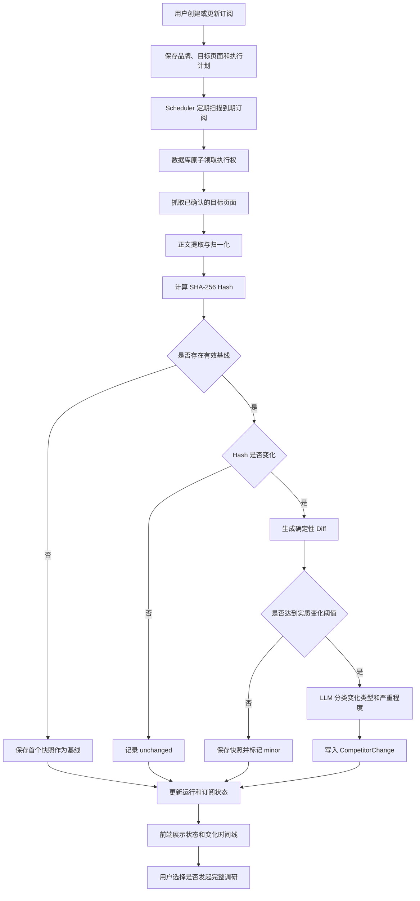

# 竞品订阅定时监控开发计划

> 文档状态：阶段 0 至阶段 8 已完成  
> 优先级：P0  
> 适用范围：`backend/` 长驻 FastAPI 服务、`api/` Serverless 接口镜像、`frontend/` React 应用  
> 目标能力：按订阅周期检查竞品公开页面，识别实质变化，保存可追溯的页面快照和变化记录，并允许用户基于变化发起完整调研。

## 1. 背景与现状

项目已经实现竞品订阅的基础数据模型和 CRUD：

- `subscriptions` 表保存 `sub_id`、查询文本、品牌列表、最近运行时间、最近报告和运行次数；
- 后端提供订阅列表、创建和删除接口；
- 完整调研流水线接收 `sub_id` 后，可以在任务完成时回写最近报告；
- 前端仪表盘可以创建和删除订阅，并查看最近报告。

现有实现仍属于「保存一个可重复使用的调研入口」，没有后台定时执行能力。当前缺少的部分包括：

1. 没有调度器和下一次执行时间；
2. 没有明确记录需要监控的页面；
3. 没有单次监控运行状态；
4. 没有页面基线、历史快照和内容 Hash；
5. 没有确定性 Diff、变化分类和严重程度；
6. 没有重复执行保护、失败恢复和快照保留策略；
7. 前端无法配置频率、品牌、页面，也无法查看变化历史。

本次开发在现有订阅能力上增加一条独立的轻量监控流水线。每次定时检查不直接运行完整 Deep Research，以控制搜索调用、LLM Token、执行时间和重复报告数量。

## 2. 目标与边界

### 2.1 P0 目标

P0 完成后，系统应支持：

- 用户为一个订阅配置品牌、监控页面、执行频率和时区；
- 长驻后端按计划自动执行监控，也支持立即执行；
- 首次成功抓取建立页面基线，不生成误报；
- 后续抓取通过稳定化正文 Hash 判断页面是否发生变化；
- 页面变化后生成确定性 Diff，并过滤微小、无业务意义的变化；
- 对实质变化调用 LLM，输出变化类型、严重程度和摘要；
- 保存订阅、目标、运行、快照和变化事件之间的关联；
- 前端展示订阅状态、运行历史和变化时间线；
- 抓取或 LLM 失败时保留运行记录，并允许后续重试；
- 多进程同时扫描时，同一订阅不会被重复执行。

### 2.2 本期不实现

以下能力不属于 P0 验收范围：

- Slack、钉钉、邮件等外部通知；
- 每次发现变化后自动执行完整 Deep Research；
- 对所有动态渲染页面统一使用 Playwright；
- Kafka、Redis、Celery 等分布式任务基础设施；
- 多租户配额、计费和权限隔离；
- 对登录后页面、验证码页面和私有页面进行监控。

P0 只提供站内变化提示和「基于变化发起调研」入口。自动生成完整报告可以在监控稳定后按严重程度策略追加。

## 3. 总体技术路线



这里有三层职责：

1. `Scheduler` 只负责发现到期订阅和触发执行；
2. `Monitor Runner` 负责抓取、快照、Hash、Diff 和运行状态；
3. `Change Classifier` 只处理已经由确定性规则确认的实质变化。

LLM 不负责判断页面是否抓取成功，也不负责计算页面是否发生字节级变化。LLM 的职责限于解释变化的业务含义。

## 4. 分阶段实施计划

## 4.1 阶段 0：确认运行边界与配置约定

> 实施状态：已完成。监控配置、长驻后端与 Serverless 边界、UTC 时间约定和快照目录约定已经写入配置及部署文档；Scheduler 默认关闭，显式启用后仅由长驻 `backend` 进程启动。

### 目标

在修改数据结构之前确定调度器运行位置、P0 支持的时间计划形式和快照保存位置，避免后续在长驻服务与 Serverless 之间反复调整。

### 工作项

1. 确认 `backend` 是 P0 调度器的唯一运行位置。
2. `api` 保留相同数据结构和手动触发接口，但在 Vercel Serverless 环境中不启动进程内调度器。
3. P0 调度计划先支持固定间隔和每日执行：
   - `interval`：每 N 分钟或小时；
   - `daily`：按订阅时区每天固定时间。
4. 数据库时间统一以 UTC ISO 8601 保存，前端按订阅时区展示。
5. 页面快照使用「SQLite 元数据 + 本地压缩文件」：
   - SQLite 保存 Hash、摘要、路径和关联关系；
   - 完整归一化正文以 gzip 文件保存在 `data/monitor_snapshots/`；
   - 快照文件使用临时文件写入后原子重命名，避免进程中断留下半文件。
6. 确定以下环境变量：

```env
SUBSCRIPTION_SCHEDULER_ENABLED=true
MONITOR_TICK_SECONDS=60
MONITOR_MAX_CONCURRENCY=3
MONITOR_FETCH_TIMEOUT=30
MONITOR_MAX_RESPONSE_BYTES=5000000
MONITOR_MAX_REDIRECTS=5
MONITOR_LEASE_SECONDS=1800
MONITOR_SNAPSHOT_RETENTION=30
MONITOR_MIN_CHANGE_RATIO=0.01
```

### 产物

- 配置字段说明；
- 长驻后端与 Serverless 的部署边界；
- 时间和快照存储约定。

### 退出条件

- 本地开发、长驻部署和 Vercel 部署各自如何触发监控已经明确；
- 不依赖浏览器页面或 SSE 连接维持定时任务；
- 快照目录和数据库路径具有持久写入权限。

## 4.2 阶段 1：数据库迁移与领域模型

> 实施状态：已完成。当前 Schema 版本为 v6，已有订阅表可增量升级；订阅、目标、运行、快照、变化事件和调研来源关联的领域对象、索引及 CRUD 已在两套后端同步实现。

### 目标

把「订阅配置」「监控目标」「一次运行」「页面快照」「变化事件」拆分为可独立查询的数据对象，并确保已有 SQLite 数据可以平滑升级。

### 工作项

#### 1. 扩展 `subscriptions`

新增：

```text
enabled
schedule_type
schedule_config
timezone
next_run_at
last_checked_at
last_success_at
last_status
consecutive_failures
monitor_error
lease_owner
lease_expires_at
updated_at
```

`schedule_config` 使用 JSON 保存不同计划的参数。现有 `last_run_at`、`last_report_id`、`run_count` 暂时保留，保证已有接口和报告关联兼容。

#### 2. 新增 `subscription_targets`

一条记录代表一个确定的监控页面：

```text
target_id
sub_id
brand
target_type        # official | pricing | blog | jobs | custom
url
enabled
last_snapshot_id
last_hash
last_checked_at
failure_count
created_at
updated_at
```

同一订阅内对规范化 URL 建立唯一约束，防止重复抓取。

#### 3. 新增 `monitor_runs`

```text
run_id
sub_id
trigger_type       # scheduled | manual | retry
scheduled_at
started_at
finished_at
status             # pending | running | succeeded | partial | failed
target_count
success_count
changed_count
search_calls
llm_tokens
duration_ms
error
created_at
```

#### 4. 新增 `page_snapshots`

```text
snapshot_id
run_id
target_id
previous_snapshot_id
source_url
final_url
http_status
content_hash
content_length
content_excerpt
snapshot_path
etag
last_modified
captured_at
```

#### 5. 新增 `competitor_changes`

```text
change_id
sub_id
run_id
target_id
previous_snapshot_id
current_snapshot_id
change_type        # pricing | feature | product | blog | jobs | policy | unknown
severity           # critical | high | medium | low | info
material
change_ratio
diff_summary
before_excerpt
after_excerpt
llm_status         # success | failed | skipped
status             # new | read | ignored
created_at
```

#### 6. 增加版本化迁移

当前 `_init_schema()` 只执行 `CREATE TABLE IF NOT EXISTS`，无法自动给已有表增加字段。本阶段增加 `schema_migrations` 表和按版本执行的迁移函数：

```text
v1：现有基础表
v2：扩展 subscriptions
v3：增加 targets、runs、snapshots、changes
v4：增加索引和唯一约束
```

迁移必须可以重复启动，不得因为字段已经存在而失败。`backend` 和 `api` 使用相同迁移版本。

### 索引

至少增加：

- `subscriptions(enabled, next_run_at)`；
- `subscription_targets(sub_id, enabled)`；
- `monitor_runs(sub_id, started_at)`；
- `page_snapshots(target_id, captured_at)`；
- `competitor_changes(sub_id, created_at)`；
- `competitor_changes(status, severity)`。

### 产物

- SQLite 增量迁移；
- 订阅监控相关 CRUD；
- 对应的 Python 数据对象或 Pydantic Schema；
- `backend` 与 `api` 数据结构一致性检查。

### 退出条件

- 使用现有 `verda.db` 启动后能自动完成迁移；
- 原有订阅和报告数据不丢失；
- 新建订阅可以保存多个目标；
- 删除或停用订阅不会留下正在被调度的孤立任务；
- 数据库索引覆盖到期扫描和历史查询。

## 4.3 阶段 2：页面抓取、归一化和快照

> 实施状态：已完成。已新增独立监控抓取器、正文归一化、SHA-256、gzip 原子快照和首次基线登记；支持条件请求、响应大小限制、逐跳重定向校验和 SSRF 地址拦截，不改变原有调研采集器行为。

### 目标

得到可重复比较的页面正文，避免广告、导航、时间戳和随机推荐造成大量误报。

### 工作项

1. 新增监控专用抓取结果，包含：
   - 原始 URL 和最终 URL；
   - HTTP 状态；
   - `ETag` 和 `Last-Modified`；
   - Content-Type 和响应体大小；
   - 提取正文；
   - 明确的错误类型。
2. 请求上一快照保存的 `ETag`、`Last-Modified`，支持条件请求和 `304 Not Modified`。
3. 使用 `trafilatura` 提取正文，BeautifulSoup 作为降级方案。
4. 正文归一化：
   - Unicode 规范化；
   - 统一换行和连续空白；
   - 移除脚本、样式、导航、页脚和 Cookie 提示；
   - 对已知时间戳、随机推荐等高噪声片段进行规则过滤；
   - 不重新排序段落，保留页面语义顺序。
5. 使用归一化正文计算 SHA-256。
6. 首次成功抓取保存基线；失败结果不得覆盖已有基线。
7. 对抓取并发、响应体大小、超时和重定向次数设置上限。
8. 增加 SSRF 防护：
   - 仅允许 `http` 和 `https`；
   - 拒绝 localhost、内网、链路本地和云元数据地址；
   - DNS 解析后校验 IP；
   - 每次重定向重新校验目标地址。

### 与现有抓取器的关系

现有 `fetch_page()` 可以复用正文提取思路，但它只返回截断正文，且异常时主要以降级结果表示。监控需要保存完整归一化正文、响应元数据和明确错误，因此新增监控抓取模块，不直接改变当前调研采集行为。

### 产物

- `monitor_fetcher.py`：安全抓取和条件请求；
- `content_normalizer.py`：正文稳定化；
- `snapshot_store.py`：压缩快照的原子读写与清理；
- 抓取、归一化、Hash 和快照单元测试。

### 退出条件

- 同一稳定页面重复抓取产生相同 Hash；
- 首次抓取只生成基线；
- `304` 可以直接记录为未变化；
- 抓取失败不会覆盖上一份有效快照；
- 非法目标地址在发出请求前被拒绝；
- 动态渲染或反爬页面会被明确标记为失败或受限，不会被解释为未变化。

## 4.4 阶段 3：Diff、实质变化过滤和 LLM 分类

> 实施状态：已完成。确定性 Diff、实质变化阈值、LLM 结构化分类、失败降级、快照对幂等和单次运行 Token 统计已在两套后端同步实现。

### 目标

把页面内容变化分成「无变化」「轻微噪声」「实质变化」，只对实质变化消耗 LLM Token。

### 工作项

1. Hash 相同时直接记录 `unchanged`。
2. Hash 不同时，使用标准库 `difflib` 计算新增、删除和替换片段。
3. 计算以下确定性指标：
   - 新增字符数；
   - 删除字符数；
   - 变化比例；
   - 变化段落数；
   - 是否命中价格、版本、功能、地区、招聘等关键词。
4. 通过阈值过滤只变化几个字符、时间戳和模板文案的情况。
5. 实质变化进入 LLM 分类，输入只包含：
   - 品牌、目标类型和 URL；
   - 变化前后的关键片段；
   - 确定性 Diff；
   - 变化比例和规则命中项。
6. LLM 使用结构化输出：

```json
{
  "material": true,
  "change_type": "pricing",
  "severity": "high",
  "summary": "企业版新增按席位计费方案",
  "facts": ["新增 Enterprise 档位", "价格由询价改为公开价格"]
}
```

7. 严重程度定义：
   - `critical`：停售、重大降价、核心产品撤回、重大合规变化；
   - `high`：定价模式、新产品或核心功能变化；
   - `medium`：一般功能更新、合作、市场扩张；
   - `low`：普通博客、招聘岗位和营销文案；
   - `info`：需要留档但无需提示的变化。
8. LLM 失败时仍保存确定性 Diff，并标记 `change_type=unknown`、`llm_status=failed`。
9. 同一组前后快照只允许生成一条变化记录，保证重试幂等。

### 产物

- `change_detector.py`：确定性 Diff 和阈值判断；
- `change_classifier.py`：LLM 结构化分类；
- 变化分类 Prompt、Schema 和错误降级；
- 变化事件 CRUD。

### 退出条件

- 微小模板变化不产生高等级事件；
- 定价、功能和产品变化能够得到稳定的类型和摘要；
- LLM 不可用时，Diff 和快照仍然完整保存；
- 重试不会重复写入同一变化；
- LLM Token 用量可以按 `monitor_run` 查询。

## 4.5 阶段 4：运行状态机、调度器与并发控制

> 实施状态：已完成。到期扫描、SQLite 原子租约、过期恢复、运行终态、目标失败停用、指数退避和 APScheduler 生命周期已经接入；`api` Serverless 入口不启动进程内调度器。

### 目标

让订阅能够按计划自动执行，并且在重启、多 Worker 和执行失败的情况下保持可恢复状态。

### 状态模型

```text
pending
  ↓ claim
running
  ├─ 全部目标成功 → succeeded
  ├─ 部分目标成功 → partial
  └─ 全部目标失败 → failed
```

订阅状态与单次运行状态分开保存。订阅可以处于 `active`、`paused`、`needs_configuration` 或 `error`，单次运行使用上面的执行状态。

### 工作项

1. 引入 APScheduler 3.x 的 `AsyncIOScheduler`。
2. 使用 FastAPI `lifespan` 启动和关闭调度器。
3. Scheduler 每隔 `MONITOR_TICK_SECONDS` 扫描到期订阅。
4. 扫描器只负责提交执行，不在调度线程内串行完成全部抓取。
5. 使用 SQLite `BEGIN IMMEDIATE` 原子领取订阅：
   - 写入 `lease_owner`；
   - 写入 `lease_expires_at`；
   - 同一订阅存在有效租约时禁止再次领取。
6. 一次运行结束后释放租约并计算新的 `next_run_at`。
7. 服务停机期间错过多个周期时，只合并为一次补跑，不批量补齐所有历史周期。
8. 进程崩溃后，过期租约可以被下一个扫描周期重新领取。
9. 单个订阅同一时间最多一个运行；全局并发量受 `MONITOR_MAX_CONCURRENCY` 控制。
10. 对目标抓取失败采用指数退避；连续失败达到阈值后暂停目标并记录原因。
11. 提供手动运行入口。手动运行和定时运行共用相同领取、执行和落库逻辑。

### 部署约束

- 本地或长驻 `backend`：允许启动 APScheduler；
- Vercel `api`：不启动 APScheduler，只保留数据结构和触发接口；
- Serverless 部署如需定时运行，由外部 Cron 调用受保护的扫描接口；
- 多实例共享 SQLite 不属于支持范围。多实例部署应改用共享数据库和独立 Worker。

### 产物

- `subscription_scheduler.py`；
- `monitor_runner.py`；
- FastAPI 生命周期接入；
- 租约、过期恢复和并发测试。

### 退出条件

- 到期订阅能够在无人打开前端时自动执行；
- 多个调度扫描器同时运行不会重复执行同一订阅；
- 后端重启后可以恢复到期订阅和过期租约；
- 暂停订阅不会再被调度；
- 单个目标失败不会阻止其他目标完成；
- 每次运行都有明确终态和错误记录。

## 4.6 阶段 5：订阅和监控 API

> 实施状态：已完成。订阅、目标、运行、变化事件、监控指标和变化发起调研等 14 组路由已经接入，支持配置校验、暂停、恢复、手动执行、目标发现与状态查询；两套后端的监控 OpenAPI 路径和方法签名一致。

### 目标

提供完整配置、运行和查询接口，让前端不需要直接理解调度器内部实现。

### 接口计划

```text
GET    /api/subscriptions
POST   /api/subscriptions
GET    /api/subscriptions/{sub_id}
PATCH  /api/subscriptions/{sub_id}
DELETE /api/subscriptions/{sub_id}

POST   /api/subscriptions/{sub_id}/run
POST   /api/subscriptions/{sub_id}/pause
POST   /api/subscriptions/{sub_id}/resume

GET    /api/subscriptions/{sub_id}/targets
POST   /api/subscriptions/{sub_id}/targets
PATCH  /api/subscriptions/{sub_id}/targets/{target_id}
DELETE /api/subscriptions/{sub_id}/targets/{target_id}

GET    /api/subscriptions/{sub_id}/runs
GET    /api/subscriptions/{sub_id}/changes
GET    /api/monitor-runs/{run_id}
PATCH  /api/competitor-changes/{change_id}
```

### 创建订阅

创建请求至少包含：

```json
{
  "query": "AI 编程助手竞争动态",
  "brands": ["Trae", "Cursor"],
  "timezone": "Asia/Shanghai",
  "schedule": {
    "type": "interval",
    "interval_minutes": 1440
  },
  "targets": [
    {
      "brand": "Trae",
      "target_type": "pricing",
      "url": "https://example.com/pricing"
    }
  ],
  "enabled": true
}
```

没有品牌或有效目标的订阅可以保存为草稿，但状态必须是 `needs_configuration`，不能进入定时扫描。

### 目标页面来源

P0 支持：

1. 用户手动输入 URL；
2. 从已有报告 Evidence 中选择官网或相关页面；
3. 创建时执行一次联网搜索，发现官网、定价、博客和招聘候选页，用户确认后保存。

正常监控周期只请求确认后的 URL，不重复消耗搜索额度。连续失败或永久重定向时再提示用户重新发现目标。

### API 约束

- 手动执行返回 HTTP `202` 和 `run_id`，不等待整轮监控完成；
- 更新计划后立即重新计算 `next_run_at`；
- 删除订阅前停止新的调度；
- P0 建议软删除订阅，保留历史运行和变化记录；
- 列表接口返回摘要，快照正文只能通过受控详情接口读取；
- `backend/app/main.py` 与 `api/index.py` 的接口行为保持一致。

### 产物

- 请求与响应 Pydantic Schema；
- 订阅、目标、运行、变化 API；
- 参数校验和统一错误结构；
- OpenAPI 接口验证。

### 退出条件

- 可以通过 API 完成创建、修改、暂停、恢复、立即执行和删除；
- 可以查询某个订阅的目标、运行历史和变化事件；
- 非法计划、时区和 URL 返回明确的 4xx 错误；
- 手动执行不会因为 HTTP 客户端断开而中止；
- 两套后端的接口 Schema 一致。

## 4.7 阶段 6：前端订阅管理与变化中心

> 实施状态：已完成。前端已新增独立竞品监控页，支持创建、编辑、暂停、恢复、立即执行、目标管理、运行历史、错误状态、变化时间线和 Diff 展开；仪表盘原有的简化创建入口已替换为状态摘要与监控中心入口。TypeScript 构建和 ESLint 已通过；当前自动化环境没有可用浏览器，截图级视觉检查待阶段 8 上线验收补充。

### 目标

让用户能够完成订阅配置、判断运行是否正常，并阅读每一次实质变化。

### 工作项

1. 扩展 TypeScript 类型：
   - `Subscription`；
   - `SubscriptionTarget`；
   - `MonitorRun`；
   - `CompetitorChange`。
2. 替换当前只提交查询文本、固定 `brands=[]` 的创建方式。
3. 增加订阅创建/编辑对话框：
   - 名称或调研需求；
   - 品牌；
   - 频率和时区；
   - 页面类型和 URL；
   - 是否立即建立基线。
4. 订阅卡片展示：
   - 启用或暂停状态；
   - 下次执行时间；
   - 最后成功时间；
   - 连续失败次数；
   - 未读变化数量；
   - 最近一次运行状态。
5. 提供立即检查、暂停、恢复、编辑和删除操作。
6. 增加订阅详情视图：
   - 监控目标列表；
   - 运行历史；
   - 错误详情；
   - 变化时间线。
7. 增加 Diff 视图：
   - 删除内容；
   - 新增内容；
   - 变化类型和严重程度；
   - LLM 摘要；
   - 来源页面和抓取时间。
8. 增加「基于变化发起调研」入口，把品牌、变化摘要、来源 URL 和时间范围带入现有任务入口。
9. P0 通过页面加载、操作后刷新和低频轮询更新状态，不新增 WebSocket。

### 产物

- 订阅创建和编辑界面；
- 订阅详情与运行历史；
- 变化时间线和 Diff 视图；
- API 调用、类型和错误状态；
- 响应式布局和空状态。

### 退出条件

- 用户可以在界面中创建一个可运行的订阅；
- 不再出现所有新订阅都保存为 `brands=[]` 的情况；
- 用户可以区分「未运行」「运行中」「部分成功」「失败」「暂停」；
- 用户可以查看变化对应的品牌、页面、前后内容和抓取时间；
- 前端刷新后状态仍来自数据库，不依赖内存状态；
- `npm run build` 和 lint 通过。

## 4.8 阶段 7：完整调研衔接与证据提升

> 实施状态：已完成。变化事件可创建带预填澄清答案的正常调研任务；当前快照先保存为任务级种子证据，进入调研时使用正式 `evidence_id`，报告完成后再写入全局 Evidence 库，并回写变化、任务、报告之间的关联。

### 目标

让监控发现的变化能够进入现有调研流程，同时保持 Evidence 和 Claim 的可追溯规则。

### 工作项

1. 用户点击「基于变化发起调研」时，创建正常调研任务。
2. 调研请求包含：
   - 订阅查询；
   - 相关品牌；
   - 变化类型和摘要；
   - 变化前后快照 ID；
   - 来源 URL；
   - 建议时间范围。
3. 把调研采用的页面快照提升为正式 Evidence：
   - 生成新的 `evidence_id`；
   - 保留 `snapshot_id`、品牌、来源 URL 和抓取时间；
   - Claim 仍然只能引用正式 Evidence ID。
4. 监控变化记录与完整报告建立关联，但监控快照本身不直接伪装为已经验证的分析结论。
5. P0 保持人工触发。后续才增加 `auto_research_on_severity`。

### 后台调研约束

当前完整调研由 SSE 异步生成器推进。未来如果要由严重变化自动触发完整调研，需要增加独立的后台 Pipeline Runner，主动消费流水线直到结束，不能依赖浏览器持续连接 `/stream`。

### 产物

- 从变化事件创建调研任务的接口和前端入口；
- Snapshot 到 Evidence 的提升逻辑；
- 变化、任务、报告之间的关联字段。

### 退出条件

- 用户可以从一条变化进入正常澄清或直接创建带预填信息的调研任务；
- 报告中的 Claim 不会直接引用 `snapshot_id`；
- 被采用的快照可以通过 Evidence 追溯到原始 URL 和监控运行；
- 未被采用的页面变化不会污染全局 Evidence 库。

## 4.9 阶段 8：测试、可观测性与上线

> 实施状态：已完成。Schema 已升级到 v6，增加 `304`、轻微变化和 LLM 分类失败统计、快照安全保留策略与监控指标接口；部署文档已补充灰度启用、观测和回滚步骤。两套后端各 70 项测试通过，前端构建和 ESLint 通过；浏览器自动化环境当前无可用浏览器，桌面与移动端截图验收仍需在具备浏览器的环境中执行。

### 目标

验证监控在重复执行、失败、重启和并发条件下仍能产生可解释的状态，并提供上线后的运行指标。

### 单元测试

1. 数据库迁移可以在新库和旧库执行。
2. URL 规范化和唯一约束正确。
3. 正文归一化对空白、导航和时间戳变化保持稳定。
4. 相同正文产生相同 Hash。
5. 首次抓取只建立基线。
6. Hash 相同时不生成变化。
7. 微小变化被规则过滤。
8. 实质变化生成 Diff。
9. LLM 成功、空输出、超时和非法 JSON 都能降级。
10. 快照文件原子写入和保留策略正确。
11. SSRF 地址和非法重定向被拒绝。

### 集成测试

1. 到期订阅可以被 Scheduler 领取并完成。
2. 两个扫描器不能同时领取同一订阅。
3. 租约过期后可以恢复执行。
4. 一个目标失败时运行状态为 `partial`，其他目标结果保留。
5. 服务重启后可以继续执行到期订阅。
6. 手动运行和定时运行使用同一执行逻辑。
7. API 可以查询完整运行和变化记录。
8. 从变化创建调研后，Snapshot 可以提升为 Evidence。
9. `backend` 和 `api` 的迁移版本、Schema 和接口响应一致。

### 前端测试

1. 创建、编辑、暂停、恢复和删除订阅；
2. 运行中、成功、部分成功和失败状态；
3. 变化列表、Diff 和错误详情；
4. 空数据、长品牌名、长 URL 和移动端布局；
5. 刷新页面后从 API 恢复状态。

### 运行指标

至少记录：

- 到期订阅数量；
- 成功、部分成功和失败运行数；
- 页面抓取成功率和平均耗时；
- `304` 命中率；
- Hash 变化率；
- 规则过滤率；
- LLM 分类次数、失败率和 Token；
- 每个订阅连续失败次数；
- 快照磁盘占用。

### 上线步骤

1. 在备份数据库上执行迁移演练。
2. 部署代码但保持 `SUBSCRIPTION_SCHEDULER_ENABLED=false`。
3. 通过手动执行验证抓取、快照、Diff 和前端展示。
4. 仅启用内部测试订阅，观察重复执行和误报情况。
5. 调整正文归一化和实质变化阈值。
6. 开启 Scheduler，限制较低并发。
7. 观察一轮完整周期后逐步增加订阅数量。

### 回滚策略

- 关闭 `SUBSCRIPTION_SCHEDULER_ENABLED` 可以立即停止新任务领取；
- 已经运行的任务允许完成或等待租约到期；
- 新表和新增字段不影响现有调研主流水线；
- 回滚应用代码时保留新表，不执行破坏性降级迁移；
- 快照目录独立，可在确认无引用后按保留策略清理。

### 退出条件

- 后端单元测试和集成测试通过；
- 前端构建和 lint 通过；
- 连续两个调度周期没有重复运行；
- 模拟重启后任务能够恢复；
- 抓取失败、LLM 失败和磁盘写入失败都有可查询状态；
- 运行指标足以定位某个订阅为什么没有产生变化。

## 5. 阶段依赖与交付顺序

```text
阶段 0 运行边界
  ↓
阶段 1 数据库与模型
  ↓
阶段 2 抓取与快照
  ↓
阶段 3 Diff 与 LLM 分类
  ↓
阶段 4 调度与并发控制
  ↓
阶段 5 API
  ↓
阶段 6 前端
  ↓
阶段 7 完整调研衔接
  ↓
阶段 8 测试与上线
```

阶段 2 和阶段 3 可以先通过命令行或测试直接调用，不需要等待 Scheduler。阶段 5 可以在阶段 4 基本稳定后并行推进。阶段 7 不阻塞定时监控 P0 上线，可以作为 P0 的最后一个增量交付。

建议形成三个可演示里程碑：

| 里程碑 | 包含阶段 | 可演示结果 |
|---|---|---|
| M1：可比较 | 0-3 | 手动输入页面，建立基线，再次抓取后得到可靠 Diff 和变化分类 |
| M2：可自动运行 | 4-5 | 订阅按时间自动执行，可查询运行状态和错误 |
| M3：可供用户使用 | 6-8 | 前端配置、变化时间线、调研衔接和上线保障完整 |

## 6. 主要代码影响面

### 后端

- `backend/app/core/db.py`：迁移、表结构和 CRUD；
- `backend/app/core/config.py`：Scheduler 和监控配置；
- `backend/app/main.py`：生命周期与 API；
- `backend/app/core/monitor_fetcher.py`：新增；
- `backend/app/core/content_normalizer.py`：新增；
- `backend/app/core/snapshot_store.py`：新增；
- `backend/app/core/change_detector.py`：新增；
- `backend/app/core/change_classifier.py`：新增；
- `backend/app/core/monitor_runner.py`：新增；
- `backend/app/core/subscription_scheduler.py`：新增；
- `backend/requirements.txt`：加入固定版本的 APScheduler。

`api/app/` 同步数据模型、业务模块和手动触发接口，但 `api/index.py` 在 Serverless 环境不启动进程内 Scheduler。

### 前端

- `frontend/src/types.ts`：新增订阅监控类型；
- `frontend/src/lib/api.ts`：新增配置、执行和历史查询接口；
- `frontend/src/pages/DashboardPage.tsx`：升级订阅摘要；
- 建议新增订阅详情页和变化 Diff 组件，避免继续把所有功能堆在仪表盘卡片中。

### 测试

- `tests/test_subscription_migrations.py`；
- `tests/test_monitor_fetcher.py`；
- `tests/test_change_detector.py`；
- `tests/test_monitor_runner.py`；
- `tests/test_subscription_scheduler.py`；
- `tests/test_subscription_api.py`。

## 7. 风险与处理策略

| 风险 | 影响 | 处理策略 |
|---|---|---|
| 页面模板频繁变化 | 产生大量误报 | 正文归一化、变化阈值、按目标类型增加过滤规则 |
| 动态渲染或反爬 | 抓不到正文 | 明确标记受限；P0 不静默降级，后续接 Playwright |
| 多 Worker 重复调度 | 重复抓取和重复变化 | SQLite 原子租约、幂等键、单订阅单活动运行 |
| LLM 超时或空输出 | 无法分类变化 | 保留确定性 Diff，标记待分类，不丢事件 |
| 快照持续增长 | 磁盘占用增加 | gzip、每目标保留上限、引用保护和定期清理 |
| Serverless 实例休眠 | 进程内定时器不执行 | 外部 Cron 或独立长驻 Worker |
| 用户提交内网 URL | SSRF 安全风险 | 协议、DNS、IP、重定向和响应大小多层校验 |
| 搜索额度被周期性消耗 | 成本不可控 | 搜索只用于首次发现和失败后的重新发现 |
| 失败覆盖有效基线 | 后续 Diff 失真 | 仅成功且正文有效的抓取可以更新基线 |

## 8. 最终验收标准

P0 只有同时满足以下条件才算完成：

1. 用户可以配置品牌、目标 URL、执行频率和时区；
2. 无需打开浏览器，长驻后端也能按计划执行；
3. 首次运行只建立基线，不生成变化误报；
4. 相同正文不会产生重复变化；
5. 实质变化有前后快照、确定性 Diff、类型、严重程度和摘要；
6. 抓取失败和 LLM 失败不会丢失运行记录，也不会覆盖有效基线；
7. 多扫描器和进程重启不会造成同一订阅重复执行；
8. 用户可以暂停、恢复、立即执行并查看历史；
9. 快照、变化、运行、订阅和后续报告可以互相追溯；
10. 定时检查不依赖 SSE 连接；
11. 正常周期不重复调用搜索服务；
12. `backend` 和 `api` 的数据结构及接口保持一致；
13. 数据库迁移、后端测试、前端构建和上线演练全部通过。

